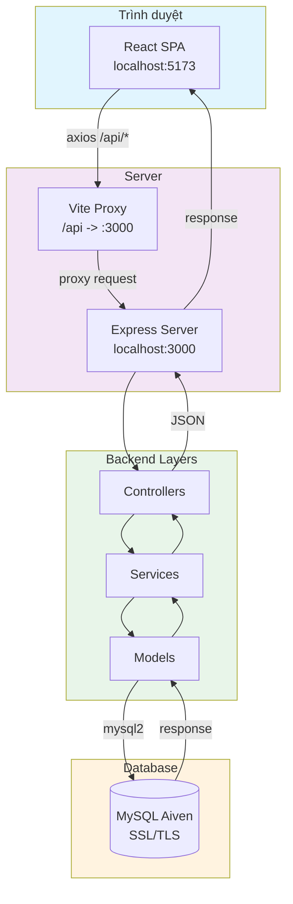
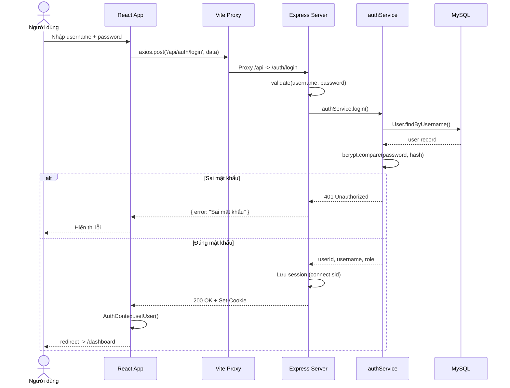
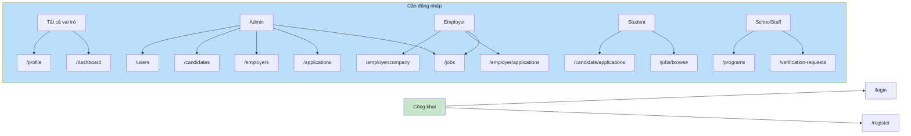
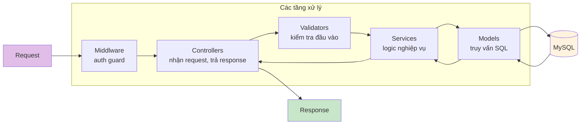
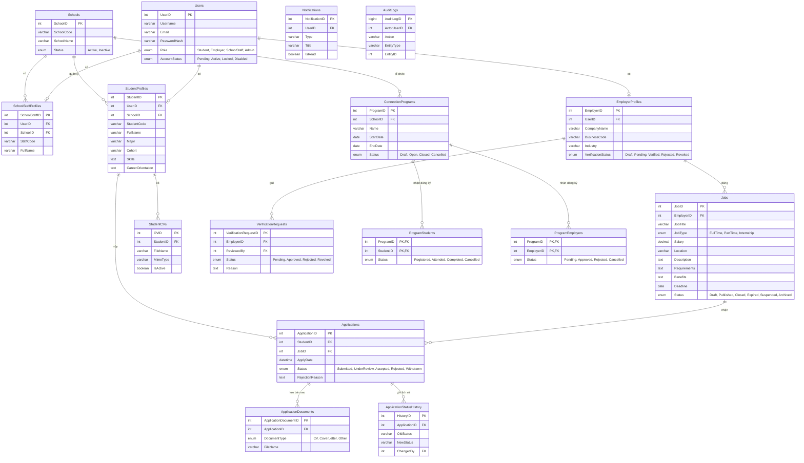
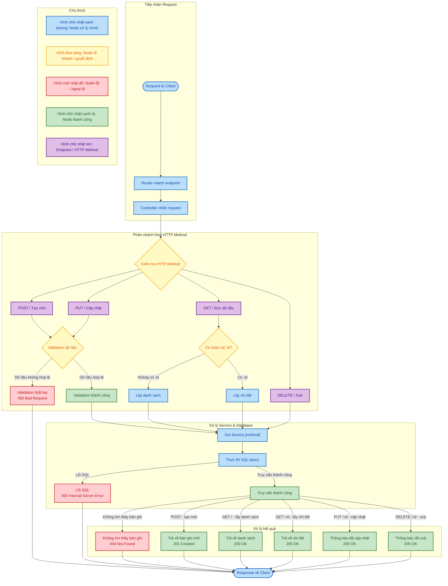

# TKWedNC-CK

> Cập nhật triển khai: backend hiện hỗ trợ kiểm tra quyền sở hữu job/ứng tuyển,
> vòng đời trạng thái ứng tuyển, thông báo nội bộ, yêu cầu xác minh doanh nghiệp
> và quản lý CV Student (PDF/DOC/DOCX tối đa 5MB). Các tài khoản mẫu dùng role
> `Student`, `Employer`, `SchoolStaff` và `Admin`.

Hệ thống kết nối Đại học - Doanh nghiệp - Monorepo với **REST API (Node.js/Express 5)** + **Frontend SPA (React/Vite)**, kết nối **MySQL** qua SSL/TLS hoặc MySQL local.

Hệ thống vẫn giữ các chức năng tuyển dụng hiện tại, đồng thời mở rộng thành nền tảng kết nối:

- **Sinh viên (`Student`)**: quản lý hồ sơ, CV, tìm việc/thực tập, ứng tuyển và đăng ký chương trình kết nối.
- **Doanh nghiệp (`Employer`)**: giới thiệu doanh nghiệp, đăng tin, xử lý hồ sơ và đăng ký tham gia chương trình.
- **Cán bộ nhà trường (`SchoolStaff`)**: thuộc một trường cụ thể, quản lý doanh nghiệp hợp tác, xác minh doanh nghiệp, tạo chương trình và xem thống kê trong phạm vi trường.
- **Quản trị viên (`Admin`)**: quản lý toàn bộ người dùng, dữ liệu và quyền truy cập.

> Hệ thống hỗ trợ nhiều trường. Mỗi `SchoolStaff` và `Student` thuộc đúng một `School`;
> chương trình kết nối thuộc một trường. Tài khoản `SchoolStaff` được Admin tạo nội bộ,
> không được đăng ký công khai.

---

## Kiến trúc tổng thể



### Chương trình kết nối

`SchoolStaff` tạo và quản lý chương trình thuộc trường của mình. Sinh viên đăng ký
tham gia bằng `POST /programs/:id/register`, doanh nghiệp đăng ký tham gia bằng
`POST /programs/:id/join`. `Admin` có thể hỗ trợ quản trị chương trình theo quyền
được cấp. Thống kê tổng quan dành cho `SchoolStaff` và `Admin` ở
`GET /programs/statistics`.

---

## Cấu trúc thư mục

```
TKWedNC-CK/
├── backend/                        # REST API
│   ├── server.js                   # Entry point
│   ├── package.json
│   └── src/
│       ├── config/
│       │   ├── database.js         # Kết nối MySQL (SSL nếu có ca.pem)
│       │   └── ca.pem              # Chứng chỉ SSL Aiven
│       ├── controllers/            # Route handlers
│       │   ├── auth.js
│       │   ├── employer.js
│       │   ├── job.js
│       │   ├── application.js
│       │   ├── candidate.js        # API hồ sơ Student (tên file tương thích cũ)
│       │   ├── cv.js
│       │   ├── notification.js
│       │   ├── verification.js
│       │   ├── program.js
│       │   ├── audit.js
│       │   └── user.js
│       ├── services/               # Logic nghiệp vụ
│       │   ├── auth.js
│       │   ├── employer.js
│       │   ├── job.js
│       │   ├── application.js
│       │   └── user.js
│       ├── models/                 # Truy vấn SQL (callback-based)
│       │   ├── User.js
│       │   ├── Employer.js
│       │   ├── Job.js
│       │   ├── Application.js
│       │   ├── Candidate.js         # Truy vấn StudentProfiles, giữ tên tương thích
│       │   ├── CV.js
│       │   ├── Notification.js
│       │   ├── Verification.js
│       │   ├── Program.js
│       │   └── AuditLog.js
│       ├── validators/             # Validation + normalize đầu vào
│       │   ├── auth.js
│       │   ├── user.js
│       │   ├── employer.js
│       │   ├── job.js
│       │   ├── application.js
│       │   └── candidate.js
│       └── middleware/
│           └── auth.js             # requireAuth, requireRole
│
├── frontend/                       # React SPA
│   ├── index.html
│   ├── vite.config.js
│   ├── package.json
│   └── src/
│       ├── main.jsx                # Entry point
│       ├── App.jsx                 # Router + Routes
│       ├── index.css               # Global styles (~1980 dòng)
│       ├── api/
│       │   └── axios.js            # Axios instance (proxy /api -> backend)
│       ├── context/
│       │   └── AuthContext.jsx     # Quản lý auth state
│       ├── components/
│       │   ├── Layout.jsx
│       │   ├── Sidebar.jsx
│       │   ├── ProtectedRoute.jsx
│       │   └── Toast.jsx
│       └── pages/
│           ├── Login.jsx
│           ├── Register.jsx
│           ├── Dashboard.jsx
│           ├── Profile.jsx
│           ├── Jobs.jsx
│           ├── JobForm.jsx
│           ├── JobDetail.jsx
│           ├── BrowseJobs.jsx
│           ├── Applications.jsx
│           ├── MyApplications.jsx
│           ├── EmployerApplications.jsx
│           ├── Employers.jsx
│           ├── Candidates.jsx        # Danh sách Student
│           ├── Users.jsx
│           └── CompanyProfile.jsx
│
├── .env.example
├── package.json                    # Root: concurrently -> backend + frontend
└── README.md
```

---

## Công nghệ sử dụng

### Backend

| Package | Version | Mục đích |
|---------|---------|----------|
| Node.js | - | Runtime |
| Express | ^5.2.1 | Web framework |
| mysql2 | ^3.22.5 | MySQL driver (SSL/TLS) |
| express-session | ^1.19.0 | Session-based auth |
| bcrypt | ^6.0.0 | Mã hoá mật khẩu |
| cookie-parser | ^1.4.7 | Parse & sign cookies |
| dotenv | ^17.4.2 | Biến môi trường |

### Frontend

| Package | Version | Mục đích |
|---------|---------|----------|
| React | ^19.2.7 | UI library |
| Vite | ^8.1.1 | Build tool & dev server |
| react-router-dom | ^7.18.1 | Client-side routing |
| axios | ^1.18.1 | HTTP client |
| dotenv | ^17.4.2 | Biến môi trường |

---

## Authentication

Hệ thống dùng **session-based authentication** (`express-session` + `cookie-parser`).

- **`requireAuth`**: Kiểm tra `req.session.userId` -> 401 nếu chưa đăng nhập.
- **`requireRole(...roles)`**: Kiểm tra `req.session.role` -> 403 nếu không có quyền.

Vai trò chính thức: `Student` | `Employer` | `SchoolStaff` | `Admin`

Quy tắc đăng ký:

- `Student` và `Employer` được đăng ký công khai.
- `SchoolStaff` và `Admin` chỉ được Admin tạo hoặc cấp nội bộ.
- Tài khoản `Employer` phải được `SchoolStaff` xác minh trước khi đăng tin.
- `Admin` không thay thế Nhà trường trong quyết định xác minh doanh nghiệp.

### Luồng đăng nhập



---

## Frontend Routes



| Path | Trang | Vai trò |
|------|-------|---------|
| `/login` | Đăng nhập | Public |
| `/register` | Đăng ký | Public |
| `/dashboard` | Tổng quan | Chung |
| `/profile` | Hồ sơ cá nhân | Chung |
| `/jobs` | Quản lý tin tuyển dụng | Admin / Employer |
| `/jobs/new` | Đăng tin mới | Admin / Employer |
| `/jobs/:id/edit` | Sửa tin | Admin / Employer |
| `/jobs/browse` | Duyệt việc làm | Student |
| `/jobs/:id` | Chi tiết việc làm | Chung |
| `/applications` | Quản lý đơn ứng tuyển | Admin |
| `/candidate/applications` | Đơn đã nộp | Student |
| `/employer/applications` | Đơn nhận được | Employer |
| `/employers` | Quản lý doanh nghiệp | Admin |
| `/candidates` | Quản lý ứng viên | Admin |
| `/users` | Quản lý tài khoản | Admin |
| `/employer/company` | Hồ sơ công ty | Employer |
| `/notifications` | Thông báo | Student / Employer / SchoolStaff / Admin |
| `/security` | Đổi mật khẩu | Tất cả vai trò |
| `/verification-requests` | Xác minh doanh nghiệp | SchoolStaff |

---

## Kiến trúc Backend (Layer-based)

Dự án tổ chức theo **tầng (layer)** - mỗi tầng có trách nhiệm riêng, request đi qua lần lượt các tầng:



### Luồng xử lý request

```
Request -> Router -> Middleware -> Controller -> Validator -> Service -> Model -> MySQL
                                |                                              |
                                +--> 401/403 nếu không có quyền                |
                                                                               v
                                                                    Response <- <- <-
```

---

## Cơ sở dữ liệu

### Sơ đồ quan hệ (ERD)



### Các bảng

| Bảng | Mục đích | Cột chính |
|------|----------|-----------|
| `Users` | Tài khoản | UserID, Username, PasswordHash, Role |
| `Schools` | Trường đại học | SchoolID, SchoolCode, SchoolName, Status |
| `SchoolStaffProfiles` | Cán bộ nhà trường | SchoolStaffID, UserID, SchoolID, StaffCode |
| `StudentProfiles` | Hồ sơ sinh viên | StudentID, UserID, SchoolID, StudentCode, Major, Skills |
| `EmployerProfiles` | Hồ sơ doanh nghiệp | EmployerID, UserID, CompanyName, BusinessCode, VerificationStatus |
| `VerificationRequests` | Yêu cầu xác minh | VerificationRequestID, EmployerID, ReviewedBy, Status, Reason |
| `Jobs` | Tin tuyển dụng | JobID, JobTitle, Salary, Location, Description, EmployerID |
| `Applications` | Đơn ứng tuyển | ApplicationID, StudentID, JobID, ApplyDate, Status |
| `StudentCVs` | CV của sinh viên | CVID, StudentID, FileName, IsActive |
| `ApplicationDocuments` | Bản sao tài liệu ứng tuyển | ApplicationDocumentID, ApplicationID, DocumentType |
| `ApplicationStatusHistory` | Lịch sử trạng thái đơn | HistoryID, ApplicationID, OldStatus, NewStatus, ChangedBy |
| `ConnectionPrograms` | Chương trình kết nối | ProgramID, SchoolID, Name, StartDate, EndDate, Status |
| `ProgramStudents` | Sinh viên tham gia chương trình | ProgramID, StudentID, Status |
| `ProgramEmployers` | Doanh nghiệp tham gia chương trình | ProgramID, EmployerID, Status |
| `Notifications` | Thông báo nội bộ | NotificationID, UserID, Title, IsRead |
| `AuditLogs` | Nhật ký quản trị | AuditLogID, ActorUserID, Action, EntityType, EntityID |

---

## Lưu đồ CRUD



---

## API Endpoints

> Gọi từ frontend: `axios.post('/api/auth/login', ...)` -> Vite proxy -> `http://localhost:3000/auth/login`
> Các endpoint trừ `/auth/register` và `/auth/login` đều yêu cầu **session cookie**.

| Method | Endpoint | Auth | Mô tả |
|--------|----------|------|-------|
| POST | `/auth/register` | - | Đăng ký |
| POST | `/auth/login` | - | Đăng nhập |
| POST | `/auth/logout` | Có | Đăng xuất |
| GET | `/auth/me` | Có | Thông tin user hiện tại |
| POST | `/auth/change-password` | Có | Đổi mật khẩu |
| POST | `/employers` | Có | Tạo doanh nghiệp |
| GET | `/employers` | Có | Danh sách doanh nghiệp |
| GET | `/employers/by-user/:userId` | Có | Hồ sơ doanh nghiệp theo tài khoản |
| GET | `/employers/:id` | Có | Chi tiết doanh nghiệp |
| PUT | `/employers/:id` | Có | Cập nhật doanh nghiệp |
| DELETE | `/employers/:id` | Admin | Xóa doanh nghiệp |
| POST | `/verification-requests` | Employer | Gửi yêu cầu xác minh |
| GET | `/verification-requests/mine` | Employer | Xem yêu cầu của mình |
| GET | `/verification-requests` | SchoolStaff / Admin | Danh sách yêu cầu |
| POST | `/verification-requests/:id/review` | SchoolStaff | Xử lý yêu cầu |
| POST | `/verification-requests/employers/:id/revoke` | SchoolStaff | Thu hồi xác minh |
| POST | `/jobs` | Có | Tạo tin tuyển dụng |
| GET | `/jobs` | Có | Danh sách tin |
| GET | `/jobs/:id` | Có | Chi tiết tin |
| PUT | `/jobs/:id` | Có | Cập nhật tin |
| DELETE | `/jobs/:id` | Có | Xoá tin |
| POST | `/applications` | Có | Nộp đơn |
| GET | `/applications` | Có | Danh sách đơn |
| GET | `/applications/:id` | Có | Chi tiết đơn |
| PUT | `/applications/:id` | Có | Cập nhật đơn |
| DELETE | `/applications/:id` | Admin | Xóa đơn theo quyền quản trị |
| POST | `/candidates` | Student | Tạo hồ sơ Student |
| GET | `/candidates/by-user/:userId` | Có | Hồ sơ Student theo tài khoản |
| GET | `/candidates` | Có | Danh sách Student theo quyền |
| GET | `/candidates/:id` | Có | Chi tiết hồ sơ Student |
| PUT | `/candidates/:id` | Student / Admin | Cập nhật hồ sơ Student |
| DELETE | `/candidates/:id` | Admin | Xóa hồ sơ Student |
| GET | `/cvs` | Student | Danh sách CV của mình |
| POST | `/cvs` | Student | Tải CV (PDF/DOC/DOCX, tối đa 5MB) |
| PUT | `/cvs/:id/active` | Student | Chọn CV đang sử dụng |
| DELETE | `/cvs/:id` | Student | Xóa CV |
| GET | `/notifications` | Có | Xem thông báo của mình |
| PUT | `/notifications/:id/read` | Có | Đánh dấu một thông báo đã đọc |
| PUT | `/notifications/read-all` | Có | Đánh dấu tất cả đã đọc |
| GET | `/programs` | Có | Danh sách chương trình công khai |
| GET | `/programs/statistics` | SchoolStaff / Admin | Thống kê chương trình |
| POST | `/programs` | SchoolStaff / Admin | Tạo chương trình |
| PUT | `/programs/:id` | SchoolStaff / Admin | Cập nhật chương trình |
| POST | `/programs/:id/register` | Student | Đăng ký chương trình |
| POST | `/programs/:id/join` | Employer | Đăng ký doanh nghiệp tham gia |
| POST | `/users` | Có | Tạo tài khoản |
| GET | `/users` | Có | Danh sách tài khoản |
| GET | `/users/:id` | Có | Chi tiết tài khoản |
| PUT | `/users/:id` | Có | Cập nhật tài khoản |
| DELETE | `/users/:id` | Có | Xoá tài khoản |
| POST | `/users/:id/status` | Admin | Khóa/mở khóa tài khoản |
| GET | `/audit-logs` | Admin | Xem nhật ký quản trị |
| GET | `/statistics/system` | Admin | Thống kê toàn hệ thống |
| GET | `/statistics/school` | SchoolStaff / Admin | Thống kê theo trường |
| POST | `/content-reports` | Có | Báo cáo nội dung vi phạm |
| GET | `/content-reports` | Admin | Danh sách báo cáo cần xử lý |
| POST | `/content-reports/:id/review` | Admin | Bỏ qua hoặc xử lý báo cáo |

> Theo BR02, Admin chỉ giám sát dữ liệu xác minh; quyết định approve/reject/revoke
> thuộc `SchoolStaff`.

### Trạng thái chuẩn

| Đối tượng | Trạng thái |
|-----------|------------|
| Tài khoản | `Pending`, `Active`, `Locked`, `Disabled` |
| Doanh nghiệp | `Draft`, `Pending`, `Verified`, `Rejected`, `Revoked` |
| Tin tuyển dụng | `Draft`, `Published`, `Closed`, `Expired`, `Suspended`, `Archived` |
| Đơn ứng tuyển | `Submitted`, `UnderReview`, `Accepted`, `Rejected`, `Withdrawn` |
| Chương trình | `Draft`, `Open`, `Closed`, `Cancelled` |

### Route utility (public)

| Method | Endpoint | Mô tả |
|--------|----------|-------|
| GET | `/visits` | Đếm số truy cập (demo session) |
| GET | `/set-cookie` | Set signed cookie |
| GET | `/read-cookie` | Đọc cookie + signed cookie |

> Cookie `connect.sid` được axios gửi tự động nhờ `withCredentials: true`.

---

## Cấu hình môi trường

Tạo file `.env` tại thư mục **gốc** project:

```env
SESSION_KEY=your_session_key_here
COOKIE_SECRET=your_cookie_secret_here

FRONTEND_PORT=5173
BACKEND_PORT=3000

DB_HOST=your_database_host
DB_PORT=your_database_port
DB_USER=avnadmin
DB_NAME=JOBRECRUITMENT
DB_PASSWORD=your_database_password_here
DB_SSL=true
```

| Biến | Bắt buộc | Mặc định | Mô tả |
|------|----------|----------|-------|
| `SESSION_KEY` | Có | - | Secret cho express-session |
| `COOKIE_SECRET` | Có | - | Secret cho signed cookies |
| `FRONTEND_PORT` | Không | `5173` | Cổng Vite dev server |
| `BACKEND_PORT` | Không | `3000` | Cổng Express server |
| `DB_HOST` | Có | - | Host MySQL Aiven |
| `DB_PORT` | Có | - | Port MySQL Aiven |
| `DB_USER` | Có | `avnadmin` | User database |
| `DB_NAME` | Có | `JOBRECRUITMENT` | Tên database |
| `DB_PASSWORD` | Có | - | Mật khẩu database |
| `DB_SSL` | Không | `false` | Bật SSL/TLS khi kết nối Aiven |
| `FRONTEND_URL` | Không | `http://localhost:5173` | URL tạo liên kết xác minh/khôi phục |
| `SMTP_HOST` | Không | - | SMTP server gửi email |
| `SMTP_PORT` | Không | `587` | Cổng SMTP |
| `SMTP_SECURE` | Không | `false` | Dùng TLS trực tiếp |
| `SMTP_USER` | Không | - | Tài khoản SMTP |
| `SMTP_PASSWORD` | Không | - | Mật khẩu SMTP |
| `SMTP_FROM` | Không | `SMTP_USER` | Địa chỉ gửi |

> Với Aiven, đặt đúng `DB_HOST`, `DB_PORT`, `DB_USER`, `DB_PASSWORD`, `DB_NAME`
> và bật SSL/TLS. Nếu service hiển thị database là `defaultdb`, dùng
> `DB_NAME=defaultdb` và đổi dòng `USE JOBRECRUITMENT;` trong
> [backend/src/reset_and_create.sql](backend/src/reset_and_create.sql) thành
> `USE defaultdb;`. Không ghi mật khẩu thật vào Git.
>
> File `backend/src/config/ca.pem` được dùng làm chứng chỉ CA khi cấu hình SSL.
> Nếu Aiven yêu cầu SSL mà thiếu chứng chỉ hoặc cấu hình sai, backend sẽ không kết nối được.

### Cập nhật database khi nâng cấp từ phiên bản tuyển dụng

Nếu cài đặt mới hoặc muốn thay thế hoàn toàn schema cũ, dùng
[backend/src/reset_and_create.sql](backend/src/reset_and_create.sql). Script này
xóa các bảng cũ, tạo schema mới và chèn dữ liệu mẫu. Không chạy trên production
nếu chưa sao lưu.

Nếu cần giữ lại dữ liệu hiện có, hãy sao lưu và thực hiện kế hoạch chuyển đổi
riêng trước khi chạy backend. Các script schema cũ dùng bảng `Candidates` và
`Employers` đã được loại bỏ vì không còn tương thích với code hiện tại.

Sau khi đã có schema chuẩn, chạy các migration mở rộng theo thứ tự:

```bash
mysql -u <user> -p < backend/src/migration_auth.sql
mysql -u <user> -p < backend/src/migration_school_employers.sql
mysql -u <user> -p < backend/src/migration_moderation.sql
```

`migration_auth.sql` để
thêm `EmailVerified`, `EmailVerificationTokens` và `PasswordResetTokens`.
Chạy migration này một lần trên mỗi database; nếu các cột đã tồn tại, không chạy
lại phần `ALTER TABLE Users`.
Tài khoản hiện có ở trạng thái `Active` được đánh dấu đã xác minh để không làm
gián đoạn người dùng cũ. Tài khoản đăng ký mới phải xác minh email trước khi
đăng nhập.

Schema sau migration dùng các role:

```text
Student | Employer | SchoolStaff | Admin
```

`SchoolStaff` không đăng ký công khai; tài khoản được tạo qua endpoint quản trị
và liên kết với `SchoolStaffProfiles.SchoolID`. Dữ liệu mẫu dùng mật khẩu
`ChangeMe123!`, chỉ dành cho môi trường phát triển.

Schema chuẩn của phiên bản mới phải có `StudentProfiles`, `EmployerProfiles`,
`SchoolStaffProfiles`, `Schools`,
`VerificationRequests`, `StudentCVs`, `ApplicationDocuments`, `Notifications`,
`AuditLogs` và các bảng liên quan chương trình.

### Tài khoản mẫu

Script reset tạo các tài khoản phát triển sau (mật khẩu chung
`ChangeMe123!`, không dùng trong production):

| Username | Role | Mục đích |
|----------|------|----------|
| `admin` | Admin | Quản trị hệ thống |
| `school.staff.01` | SchoolStaff | Quản lý trường và xác minh doanh nghiệp |
| `employer.acme` | Employer | Quản lý hồ sơ, tin tuyển dụng và ứng tuyển |
| `student.an` | Student | Quản lý hồ sơ, CV và ứng tuyển |

### Xác minh email và khôi phục mật khẩu

- Đăng ký mới yêu cầu email hợp lệ và tạo tài khoản ở trạng thái `Pending`.
- Liên kết xác minh có thời hạn 30 phút và chỉ dùng một lần.
- `POST /auth/verify-email` kích hoạt tài khoản.
- `POST /auth/resend-verification` gửi lại liên kết xác minh.
- `POST /auth/forgot-password` tạo liên kết khôi phục có thời hạn 30 phút.
- `POST /auth/reset-password` đổi mật khẩu bằng token hợp lệ.
- Khi chưa cấu hình SMTP, môi trường development ghi URL dùng một lần vào log;
  production bắt buộc phải cấu hình SMTP.

---

## Hướng dẫn chạy

```bash
# 1. Cài tất cả dependencies
npm install
cd backend && npm install && cd ..
cd frontend && npm install && cd ..

# 2. Tạo file .env
cp .env.example .env
# điền các thông số phù hợp

# 3. Khởi động cả backend lẫn frontend
npm run dev
```

Sau đó:
- **Frontend**: http://localhost:5173
- **Backend**: http://localhost:3000

### Chạy riêng từng phần

```bash
# Chỉ backend
npm run dev --prefix backend

# Chỉ frontend
npm run dev --prefix frontend
```

---

## Thử nghiệm với curl

```bash
# Đăng ký tài khoản Student
curl -X POST http://localhost:3000/auth/register \
  -H "Content-Type: application/json" \
  -d '{"username":"student.test","email":"student.test@example.com","password":"ChangeMe123!","role":"Student"}'

# Đăng nhập
curl -X POST http://localhost:3000/auth/login \
  -H "Content-Type: application/json" \
  -d '{"username":"test1","password":"123456"}'

# Tạo hồ sơ doanh nghiệp (đăng nhập trước và giữ session cookie)
curl -X POST http://localhost:3000/employers \
  -H "Content-Type: application/json" \
  -b cookies.txt -c cookies.txt \
  -d '{"companyName":"Acme Corp","businessCode":"ACME-002","industry":"Công nghệ thông tin","email":"acme@example.com","phone":"0123456789","address":"TP.HCM"}'

# Tạo tin tuyển dụng
curl -X POST http://localhost:3000/jobs \
  -H "Content-Type: application/json" \
  -b cookies.txt \
  -d '{"jobTitle":"Backend Developer","jobType":"FullTime","location":"Remote","salary":2500,"deadline":"2027-12-31","description":"Node.js role","requirements":"Node.js, MySQL","benefits":"Bảo hiểm và đào tạo"}'

# Tạo hồ sơ Student
curl -X POST http://localhost:3000/candidates \
  -H "Content-Type: application/json" \
  -b cookies.txt \
  -d '{"schoolId":1,"studentCode":"SV20270001","fullName":"John Doe","email":"john@example.com","phone":"0987654321","major":"Công nghệ phần mềm","cohort":"K2027","skills":"Node.js, MySQL","careerOrientation":"Backend Developer"}'

# Nộp đơn ứng tuyển (StudentID lấy từ session, không gửi candidateId)
curl -X POST http://localhost:3000/applications \
  -H "Content-Type: application/json" \
  -b cookies.txt \
  -d '{"jobId":1,"cvId":1}'
```

> Trạng thái ban đầu của đơn là `"Submitted"`. Backend tự xác định `StudentID`
> từ session, kiểm tra tin còn hiệu lực và ngăn ứng tuyển trùng cho cùng một
> sinh viên/tin tuyển dụng. Các request cần giữ session cookie bằng `-c cookies.txt`
> và `-b cookies.txt`.

### Ví dụ quản lý CV và thông báo

```bash
# Liệt kê CV của Student
curl http://localhost:3000/cvs -b cookies.txt

# Đánh dấu một CV là CV đang sử dụng
curl -X PUT http://localhost:3000/cvs/1/active -b cookies.txt

# Xem thông báo
curl http://localhost:3000/notifications -b cookies.txt

# Đánh dấu tất cả thông báo đã đọc
curl -X PUT http://localhost:3000/notifications/read-all -b cookies.txt
```

### Chức năng đã triển khai trong phiên bản hiện tại

- Xác minh email, gửi lại liên kết và khôi phục mật khẩu bằng token dùng một lần.
- Lọc/phân trang Jobs, Students, Employers và Applications.
- Scheduler chuyển Job quá hạn sang `Expired`, tạo notification và audit log.
- API/dashboard thống kê cho Admin và SchoolStaff.
- Báo cáo nội dung Job, Admin xử lý hoặc tạm ngưng tin, kèm notification/audit.
- Quan hệ `SchoolEmployers` để lưu doanh nghiệp được trường xác nhận.

Các phần còn lại cần hoàn thiện:

- Cấu hình SMTP production và test email end-to-end.
- Bộ lọc/phân trang tương ứng cho mọi màn hình frontend.
- Thống kê theo khoảng thời gian và biểu đồ nâng cao.
- Báo cáo vi phạm cho nhiều loại nội dung ngoài Job.
- RBAC động; hiện bốn role cố định vẫn là mô hình được sử dụng.
1.4. Các yêu cầu chức năng
Hệ thống kết nối nhiều trường đại học với doanh nghiệp trong lĩnh vực tuyển dụng, thực tập và định hướng nghề nghiệp cho sinh viên. Thông qua hệ thống, sinh viên có thể xây dựng hồ sơ cá nhân, tìm kiếm cơ hội việc làm và thực tập, đồng thời theo dõi quá trình ứng tuyển. Doanh nghiệp có thể quản lý thông tin tổ chức, đăng tải tin tuyển dụng, tiếp nhận và xem xét hồ sơ ứng viên. Bên cạnh đó, cán bộ từng trường có thể quản lý các doanh nghiệp hợp tác, tổ chức chương trình kết nối và theo dõi kết quả hoạt động trong phạm vi trường; quản trị viên chịu trách nhiệm quản lý tài khoản và vận hành toàn hệ thống.
Để đáp ứng các mục tiêu trên, hệ thống cần cung cấp các chức năng phù hợp với từng nhóm đối tượng sử dụng, bảo đảm sự liên kết giữa các nghiệp vụ và tính nhất quán của dữ liệu. Các yêu cầu chức năng được phân chia thành bảy nhóm chính như sau.
R1. Các yêu cầu về quản lý tài khoản và xác thực
Hệ thống phục vụ bốn nhóm người dùng chính, bao gồm sinh viên, doanh nghiệp, nhà trường và quản trị viên. Mỗi nhóm người dùng có mục đích sử dụng và phạm vi quyền hạn khác nhau, do đó hệ thống cần cung cấp các chức năng xác thực và quản lý tài khoản phù hợp. Sinh viên và doanh nghiệp được phép tự đăng ký tài khoản, trong khi tài khoản dành cho nhà trường và quản trị viên được cấp bởi người có thẩm quyền. Các chức năng quản lý tài khoản bao gồm đăng ký, đăng nhập, đăng xuất, cập nhật thông tin cá nhân, quản lý mật khẩu và kiểm soát quyền truy cập.

     R1.1. Hệ thống cho phép người dùng đăng ký tài khoản
Chức năng này cho phép sinh viên và doanh nghiệp tự đăng ký tài khoản để sử dụng các chức năng được cung cấp trên hệ thống. Người dùng cần lựa chọn loại tài khoản phù hợp và cung cấp các thông tin bắt buộc như email, mật khẩu cùng những thông tin đăng ký cần thiết. Hệ thống tiến hành kiểm tra tính hợp lệ của dữ liệu, xác định email đã tồn tại hay chưa và tạo tài khoản tương ứng nếu thông tin đáp ứng các điều kiện quy định. Sau khi đăng ký thành công, Student/Employer phải xác minh email qua liên kết
được gửi đến hộp thư trước khi đăng nhập để hoàn thiện hồ sơ cá nhân hoặc hồ sơ
doanh nghiệp; riêng tài khoản Nhà trường và Quản trị viên không được phép đăng
ký công khai mà phải được cấp bởi người có thẩm quyền.

     R1.2. Hệ thống cho phép người dùng đăng nhập
Chức năng này cho phép sinh viên, doanh nghiệp, nhà trường và quản trị viên đăng nhập vào hệ thống bằng email và mật khẩu của tài khoản đã được đăng ký hoặc cấp trước đó. Khi nhận yêu cầu đăng nhập, hệ thống thực hiện xác thực thông tin, kiểm tra trạng thái tài khoản và xác định vai trò đã được lưu trữ. Nếu thông tin hợp lệ và tài khoản đang hoạt động, hệ thống tạo phiên đăng nhập và cho phép người dùng truy cập các chức năng tương ứng với quyền hạn được cấp. Trường hợp thông tin không chính xác hoặc tài khoản bị khóa, hệ thống từ chối đăng nhập và hiển thị thông báo phù hợp.

     R1.3. Hệ thống cho phép người dùng đăng xuất
Chức năng này cho phép tất cả người dùng đã đăng nhập chủ động kết thúc phiên làm việc khi không còn nhu cầu sử dụng hệ thống. Khi lựa chọn chức năng đăng xuất, hệ thống thực hiện hủy hiệu lực phiên đăng nhập hiện tại và ngăn việc tiếp tục sử dụng các chức năng yêu cầu xác thực bằng phiên đó. Sau khi hoàn tất, người dùng được chuyển về giao diện đăng nhập hoặc trang công khai của hệ thống. Chức năng này góp phần bảo vệ thông tin tài khoản và hạn chế nguy cơ truy cập trái phép từ thiết bị đã được sử dụng.
     R1.4. Hệ thống cho phép người dùng quản lý thông tin tài khoản cá nhân
Chức năng này cho phép sinh viên, doanh nghiệp, nhà trường và quản trị viên xem và cập nhật những thông tin tài khoản thuộc quyền quản lý của mình. Người dùng có thể chỉnh sửa các thông tin được phép thay đổi như tên hiển thị, số điện thoại và thông tin liên hệ, nhưng không được tự ý thay đổi vai trò hoặc quyền truy cập đã được cấp. Khi có yêu cầu cập nhật, hệ thống kiểm tra tính hợp lệ của dữ liệu và thực hiện lưu trữ những thay đổi hợp lệ vào cơ sở dữ liệu. Sau khi hoàn thành, hệ thống hiển thị thông tin mới và thông báo kết quả cập nhật cho người dùng.

     R1.5. Hệ thống cho phép người dùng thay đổi và khôi phục mật khẩu
Chức năng này cho phép các nhóm người dùng thay đổi mật khẩu để bảo vệ tài khoản hoặc khôi phục quyền truy cập khi quên mật khẩu. Đối với thao tác thay đổi mật khẩu, hệ thống yêu cầu người dùng cung cấp thông tin xác thực cần thiết và mật khẩu mới đáp ứng các quy định bảo mật. Trong trường hợp quên mật khẩu, người dùng có thể gửi yêu cầu khôi phục thông qua email đã liên kết với tài khoản để thực hiện quy trình xác minh quyền sở hữu. Sau khi xác minh thành công, hệ thống cập nhật mật khẩu mới dưới dạng được bảo vệ an toàn và thông báo kết quả thực hiện.

     R1.6. Hệ thống cho phép kiểm soát quyền truy cập theo vai trò người dùng
Chức năng này bảo đảm mỗi nhóm người dùng chỉ có thể truy cập các chức năng phù hợp với nhiệm vụ và quyền hạn của mình trong hệ thống. Sau khi người dùng đăng nhập, hệ thống xác định vai trò tương ứng gồm Sinh viên, Doanh nghiệp, Nhà trường hoặc Quản trị viên và áp dụng các quyền truy cập đã được cấu hình. Khi người dùng thực hiện một thao tác, hệ thống kiểm tra quyền hạn trước khi cho phép truy xuất dữ liệu hoặc xử lý yêu cầu. Những thao tác không thuộc phạm vi được cấp quyền sẽ bị từ chối nhằm bảo đảm an toàn thông tin và ngăn chặn việc sử dụng sai chức năng.
R2. Các yêu cầu về quản lý hồ sơ sinh viên
Hồ sơ sinh viên là thành phần quan trọng giúp thể hiện thông tin học tập, trình độ chuyên môn, kỹ năng và kinh nghiệm của người ứng tuyển. Mỗi hồ sơ sinh viên thuộc đúng một trường và được định danh bằng cặp `SchoolID`–`StudentCode`. Nhóm chức năng này hỗ trợ sinh viên xây dựng, cập nhật và quản lý hồ sơ cá nhân, đồng thời cho phép doanh nghiệp tiếp cận thông tin của những sinh viên đã ứng tuyển vào các vị trí tuyển dụng thuộc quyền quản lý của mình.

     R2.1. Hệ thống cho phép sinh viên tạo hồ sơ cá nhân
Chức năng này cho phép sinh viên tạo hồ sơ cá nhân sau khi đăng ký và đăng nhập thành công vào hệ thống. Sinh viên cần cung cấp các thông tin như họ tên, mã sinh viên, thông tin liên hệ, ngành học, khóa học và trình độ học vấn tại trường đại học đang sử dụng hệ thống. Hệ thống kiểm tra tính đầy đủ và hợp lệ của các thông tin bắt buộc trước khi tạo hồ sơ và liên kết với tài khoản sinh viên tương ứng. Sau khi hồ sơ được tạo thành công, sinh viên có thể tiếp tục bổ sung các thông tin về kỹ năng, kinh nghiệm và tài liệu CV để phục vụ quá trình ứng tuyển.

     R2.2. Hệ thống cho phép sinh viên cập nhật kỹ năng, kinh nghiệm và định hướng nghề nghiệp
Chức năng này cho phép sinh viên bổ sung và chỉnh sửa các thông tin liên quan đến năng lực chuyên môn, kỹ năng cá nhân, kinh nghiệm thực tế và định hướng nghề nghiệp. Sinh viên có thể cập nhật các kỹ năng đã đạt được, dự án từng tham gia, kinh nghiệm làm việc hoặc lĩnh vực công việc mong muốn. Hệ thống tiếp nhận các thay đổi, kiểm tra tính hợp lệ của dữ liệu và cập nhật nội dung vào hồ sơ sinh viên. Những thông tin đã được cập nhật sẽ hỗ trợ doanh nghiệp đánh giá mức độ phù hợp của sinh viên với yêu cầu tuyển dụng.

     R2.3. Hệ thống cho phép sinh viên quản lý CV
Chức năng này cho phép sinh viên tải lên, xem và thay thế tài liệu CV được sử dụng trong quá trình ứng tuyển việc làm hoặc thực tập. Khi sinh viên tải tài liệu lên, hệ thống thực hiện kiểm tra định dạng tệp, kích thước và các điều kiện hợp lệ trước khi lưu trữ. Những CV đáp ứng yêu cầu được liên kết với hồ sơ sinh viên và có thể được lựa chọn khi thực hiện ứng tuyển vào một tin tuyển dụng. Đối với CV đã được gửi kèm hồ sơ ứng tuyển, hệ thống cần lưu giữ phiên bản tài liệu được sử dụng tại thời điểm ứng tuyển để tránh làm thay đổi thông tin mà doanh nghiệp đã tiếp nhận.

      R2.4. Hệ thống cho phép sinh viên xem và chỉnh sửa hồ sơ cá nhân
Chức năng này cho phép sinh viên truy cập hồ sơ cá nhân để kiểm tra những thông tin đã được lưu trữ trên hệ thống. Sinh viên có thể xem các thông tin cơ bản, thông tin học tập, kỹ năng, kinh nghiệm, định hướng nghề nghiệp và các tài liệu CV có liên quan. Khi phát hiện nội dung chưa chính xác hoặc cần bổ sung, sinh viên có thể lựa chọn các trường thông tin được phép chỉnh sửa và gửi yêu cầu cập nhật. Hệ thống kiểm tra tính hợp lệ của dữ liệu, lưu các thay đổi và hiển thị nội dung hồ sơ mới sau khi cập nhật thành công.

     R2.5. Hệ thống cho phép doanh nghiệp xem hồ sơ sinh viên đã ứng tuyển
Chức năng này cho phép doanh nghiệp xem thông tin hồ sơ của những sinh viên đã gửi đơn ứng tuyển vào các tin tuyển dụng do doanh nghiệp đăng tải. Khi truy cập danh sách ứng viên, doanh nghiệp có thể lựa chọn từng hồ sơ để xem thông tin học vấn, kỹ năng, kinh nghiệm và CV được gửi kèm trong lần ứng tuyển tương ứng. Hệ thống kiểm tra quyền truy cập của doanh nghiệp và chỉ cung cấp dữ liệu thuộc các hồ sơ ứng tuyển mà doanh nghiệp có quyền tiếp nhận, xử lý. Những thông tin được hiển thị giúp doanh nghiệp đánh giá khả năng đáp ứng yêu cầu công việc của từng ứng viên và đưa ra quyết định tuyển dụng phù hợp.
R3. Các yêu cầu về quản lý thông tin doanh nghiệp
Doanh nghiệp là đối tượng cung cấp các cơ hội thực tập và việc làm cho sinh viên thông qua hệ thống. Để bảo đảm độ tin cậy của thông tin tuyển dụng, mỗi doanh nghiệp cần xây dựng hồ sơ giới thiệu và được Nhà trường xác minh trước khi tham gia hoạt động đăng tuyển. Nhóm chức năng này hỗ trợ doanh nghiệp quản lý thông tin tổ chức, gửi yêu cầu xác minh và theo dõi kết quả xử lý, đồng thời cho phép sinh viên tìm hiểu những thông tin doanh nghiệp được công khai trên hệ thống.

     R3.1. Hệ thống cho phép doanh nghiệp tạo hồ sơ doanh nghiệp
Chức năng này cho phép người dùng có vai trò Doanh nghiệp tạo hồ sơ giới thiệu về tổ chức sau khi đăng ký và đăng nhập thành công. Doanh nghiệp cần cung cấp các thông tin như tên doanh nghiệp, lĩnh vực hoạt động, địa chỉ trụ sở, thông tin liên hệ và nội dung giới thiệu về tổ chức. Hệ thống kiểm tra các trường thông tin bắt buộc, xác định tính hợp lệ của dữ liệu và tạo hồ sơ liên kết với tài khoản doanh nghiệp tương ứng. Sau khi hoàn thành, hồ sơ được lưu trữ để doanh nghiệp tiếp tục cập nhật và gửi yêu cầu xác minh đến Nhà trường.

     R3.2. Hệ thống cho phép doanh nghiệp xem và cập nhật thông tin hồ sơ
Chức năng này cho phép doanh nghiệp xem và chỉnh sửa các thông tin giới thiệu về tổ chức đã được lưu trữ trên hệ thống. Doanh nghiệp có thể cập nhật địa chỉ liên hệ, lĩnh vực hoạt động, thông tin đại diện hoặc những nội dung khác được hệ thống cho phép thay đổi. Khi tiếp nhận yêu cầu, hệ thống kiểm tra quyền chỉnh sửa và tính hợp lệ của dữ liệu trước khi lưu thông tin mới. Đối với những thay đổi ảnh hưởng đến kết quả xác minh, hệ thống có thể chuyển hồ sơ sang trạng thái cần xác minh lại theo quy định nhằm bảo đảm độ tin cậy của thông tin doanh nghiệp.

     R3.3. Hệ thống cho phép doanh nghiệp gửi yêu cầu xác minh hồ sơ
Chức năng này cho phép doanh nghiệp gửi hồ sơ đến Nhà trường để được xem xét và xác minh tư cách tham gia hoạt động tuyển dụng trên hệ thống. Sau khi hoàn thiện các thông tin bắt buộc, doanh nghiệp có thể lựa chọn chức năng gửi yêu cầu xác minh từ giao diện quản lý hồ sơ. Hệ thống kiểm tra tính đầy đủ của hồ sơ, trạng thái xác minh hiện tại và điều kiện gửi yêu cầu trước khi ghi nhận thông tin. Nếu yêu cầu hợp lệ, hệ thống tạo yêu cầu xác minh với trạng thái đang chờ xử lý và đưa hồ sơ vào danh sách để Nhà trường xem xét.

     R3.4. Hệ thống cho phép doanh nghiệp theo dõi trạng thái xác minh hồ sơ
Chức năng này cho phép doanh nghiệp kiểm tra tình trạng xử lý hồ sơ xác minh sau khi gửi yêu cầu đến Nhà trường. Doanh nghiệp có thể xem các trạng thái như đang chờ xác minh, đã được xác minh hoặc bị từ chối, đồng thời xem thông tin phản hồi nếu có. Hệ thống truy xuất kết quả xử lý mới nhất và hiển thị tại giao diện quản lý hồ sơ doanh nghiệp. Trường hợp hồ sơ bị từ chối, doanh nghiệp có thể căn cứ vào thông tin phản hồi để bổ sung, điều chỉnh nội dung và gửi lại yêu cầu xác minh theo quy định.

     R3.5. Hệ thống cho phép sinh viên xem thông tin doanh nghiệp tuyển dụng
Chức năng này cho phép sinh viên tìm hiểu thông tin của những doanh nghiệp có tin tuyển dụng được công bố trên hệ thống. Khi lựa chọn xem thông tin doanh nghiệp từ một tin tuyển dụng, sinh viên có thể tiếp cận các nội dung công khai như tên doanh nghiệp, lĩnh vực hoạt động, địa chỉ, thông tin giới thiệu và các vị trí tuyển dụng liên quan. Hệ thống truy xuất hồ sơ doanh nghiệp tương ứng và hiển thị các thông tin được phép công khai. Chức năng này giúp sinh viên có thêm cơ sở đánh giá mức độ phù hợp của doanh nghiệp trước khi quyết định ứng tuyển.
R4. Các yêu cầu về quản lý tin tuyển dụng
Tin tuyển dụng là phương tiện chính để doanh nghiệp công bố nhu cầu tuyển dụng việc làm và thực tập đến sinh viên. Hệ thống cần cung cấp các chức năng hỗ trợ doanh nghiệp tạo, chỉnh sửa, theo dõi và quản lý tin tuyển dụng, đồng thời kiểm soát điều kiện đăng tin và thời hạn tiếp nhận hồ sơ. Chỉ những doanh nghiệp đã được Nhà trường xác minh và có tài khoản đang hoạt động mới được phép đăng tải tin tuyển dụng. Những tin đã phát sinh hồ sơ ứng tuyển cần được quản lý phù hợp để bảo đảm tính toàn vẹn của dữ liệu.

     R4.1. Hệ thống cho phép doanh nghiệp đăng tin tuyển dụng
Chức năng này cho phép doanh nghiệp đã được Nhà trường xác minh đăng tải các tin tuyển dụng việc làm hoặc thực tập dành cho sinh viên. Khi tạo tin, doanh nghiệp cần cung cấp các thông tin như tên vị trí, mô tả công việc, yêu cầu ứng viên, số lượng tuyển dụng, địa điểm làm việc, hình thức làm việc và thời hạn nhận hồ sơ. Hệ thống kiểm tra trạng thái hoạt động của tài khoản, trạng thái xác minh doanh nghiệp và tính hợp lệ của các thông tin bắt buộc trước khi tiếp nhận yêu cầu. Nếu đáp ứng các điều kiện quy định, tin tuyển dụng được lưu trữ và công bố để sinh viên có thể tìm kiếm, xem chi tiết và thực hiện ứng tuyển.

     R4.2. Hệ thống cho phép doanh nghiệp cập nhật tin tuyển dụng
Chức năng này cho phép doanh nghiệp chỉnh sửa nội dung các tin tuyển dụng do mình tạo ra khi nhu cầu tuyển dụng có sự thay đổi. Doanh nghiệp có thể cập nhật mô tả công việc, yêu cầu ứng viên, số lượng tuyển dụng, địa điểm làm việc hoặc thời hạn nhận hồ sơ theo các điều kiện chỉnh sửa được quy định. Hệ thống kiểm tra quyền quản lý đối với tin tuyển dụng, trạng thái hiện tại và tính hợp lệ của dữ liệu trước khi thực hiện cập nhật. Sau khi yêu cầu được chấp nhận, nội dung tin tuyển dụng được thay đổi và hiển thị theo thông tin mới nhất.


      R4.3. Hệ thống cho phép doanh nghiệp xem và quản lý danh sách tin tuyển dụng
Chức năng này cho phép doanh nghiệp theo dõi toàn bộ những tin tuyển dụng đã được tạo bằng tài khoản của mình. Hệ thống hiển thị danh sách các tin tuyển dụng cùng thông tin cơ bản như tên vị trí, ngày đăng, thời hạn nhận hồ sơ và trạng thái hoạt động. Doanh nghiệp có thể tìm kiếm, lọc danh sách theo các tiêu chí phù hợp và lựa chọn từng tin để xem thông tin chi tiết hoặc thực hiện các thao tác quản lý được cấp quyền. Chức năng này hỗ trợ doanh nghiệp kiểm soát tình hình đăng tuyển và chủ động điều chỉnh kế hoạch tuyển dụng.

     R4.4. Hệ thống cho phép doanh nghiệp đóng hoặc xóa tin tuyển dụng
Chức năng này cho phép doanh nghiệp ngừng tiếp nhận hồ sơ hoặc yêu cầu xóa những tin tuyển dụng không còn phù hợp với nhu cầu tuyển dụng. Khi doanh nghiệp thực hiện thao tác, hệ thống kiểm tra quyền sở hữu tin, trạng thái hiện tại và sự tồn tại của các hồ sơ ứng tuyển có liên quan trước khi xử lý. Đối với chức năng đóng tin, hệ thống cập nhật trạng thái và ngừng tiếp nhận hồ sơ mới; đối với yêu cầu xóa tin đã phát sinh hồ sơ ứng tuyển, hệ thống thực hiện ẩn hoặc xóa mềm để bảo toàn dữ liệu cần lưu giữ. Sau khi hoàn tất, trạng thái tin tuyển dụng và danh sách quản lý được cập nhật tương ứng.

     R4.5. Hệ thống cho phép tự động kiểm soát hiệu lực của tin tuyển dụng
Chức năng này cho phép hệ thống kiểm soát thời hạn tiếp nhận hồ sơ và trạng thái hoạt động của các tin tuyển dụng đã được đăng tải. Khi một tin tuyển dụng hết thời hạn hoặc đã được doanh nghiệp đóng, hệ thống xác định tin không còn đủ điều kiện nhận hồ sơ ứng tuyển mới. Nếu sinh viên gửi yêu cầu ứng tuyển vào tin không còn hiệu lực, hệ thống từ chối tạo hồ sơ và hiển thị thông báo phù hợp. Chức năng này giúp hạn chế các trường hợp ứng tuyển vào vị trí đã ngừng tuyển và bảo đảm tính chính xác của thông tin tuyển dụng.
R5. Các yêu cầu về tìm kiếm, ứng tuyển và quản lý ứng viên
Tìm kiếm việc làm và ứng tuyển là nghiệp vụ trung tâm của hệ thống kết nối đại học với doanh nghiệp. Nhóm chức năng này hỗ trợ sinh viên tìm kiếm các vị trí phù hợp với năng lực, gửi hồ sơ ứng tuyển và theo dõi kết quả xử lý. Đồng thời, hệ thống hỗ trợ doanh nghiệp tiếp nhận, xem xét và cập nhật trạng thái hồ sơ ứng viên. Để bảo đảm tính chính xác của dữ liệu, mỗi sinh viên chỉ được tạo một hồ sơ ứng tuyển đối với một tin tuyển dụng cụ thể trong phạm vi chức năng hiện tại.

     R5.1. Hệ thống cho phép sinh viên tìm kiếm tin tuyển dụng
Chức năng này cho phép sinh viên tìm kiếm những cơ hội việc làm và thực tập được doanh nghiệp đăng tải trên hệ thống. Sinh viên có thể nhập từ khóa hoặc lựa chọn các tiêu chí tìm kiếm như vị trí công việc, lĩnh vực chuyên môn, địa điểm làm việc và loại hình tuyển dụng. Hệ thống tiếp nhận các tiêu chí, truy xuất những tin tuyển dụng phù hợp và chỉ hiển thị các tin được phép công khai. Kết quả được trình bày dưới dạng danh sách để sinh viên dễ dàng lựa chọn những vị trí phù hợp với nhu cầu của mình.

     R5.2. Hệ thống cho phép sinh viên xem thông tin chi tiết tin tuyển dụng
Chức năng này cho phép sinh viên xem đầy đủ nội dung của các tin tuyển dụng trước khi quyết định gửi hồ sơ ứng tuyển. Khi lựa chọn một tin tuyển dụng, sinh viên có thể xem các thông tin như vị trí công việc, mô tả nhiệm vụ, yêu cầu ứng viên, địa điểm làm việc, chế độ đãi ngộ nếu có và thời hạn nhận hồ sơ. Hệ thống truy xuất dữ liệu tin tuyển dụng tương ứng, đồng thời xác định và hiển thị trạng thái tiếp nhận hồ sơ tại thời điểm truy cập. Những thông tin này giúp sinh viên đánh giá mức độ phù hợp giữa năng lực cá nhân và yêu cầu của doanh nghiệp.

      R5.3. Hệ thống cho phép sinh viên gửi hồ sơ ứng tuyển
Chức năng này cho phép sinh viên gửi hồ sơ ứng tuyển vào những tin tuyển dụng đang trong thời gian tiếp nhận hồ sơ. Sau khi lựa chọn vị trí mong muốn, sinh viên có thể sử dụng hồ sơ cá nhân và lựa chọn CV phù hợp để gửi đến doanh nghiệp tuyển dụng. Hệ thống thực hiện kiểm tra các điều kiện ứng tuyển, bao gồm trạng thái tin tuyển dụng, thông tin hồ sơ bắt buộc và tình trạng ứng tuyển trước đó của sinh viên. Nếu yêu cầu hợp lệ, hệ thống tạo hồ sơ ứng tuyển mới, lưu thông tin và phiên bản CV được gửi tại thời điểm ứng tuyển, đồng thời thiết lập trạng thái ban đầu là Đã gửi.

     R5.4. Hệ thống cho phép kiểm tra tính hợp lệ và ngăn ứng tuyển trùng lặp
Chức năng này được hệ thống thực hiện trong quá trình xử lý yêu cầu ứng tuyển của sinh viên nhằm bảo đảm tính hợp lệ và chính xác của dữ liệu. Hệ thống kiểm tra người dùng đã đăng nhập với vai trò Sinh viên, có hồ sơ đáp ứng thông tin bắt buộc, đồng thời xác định tin tuyển dụng còn hiệu lực và đang tiếp nhận hồ sơ. Ngoài ra, hệ thống kiểm tra sự tồn tại của hồ sơ ứng tuyển có cùng mã sinh viên và mã tin tuyển dụng để ngăn việc tạo nhiều hồ sơ trùng lặp. Nếu phát hiện điều kiện không hợp lệ, hệ thống từ chối yêu cầu và thông báo nguyên nhân; ngược lại, quá trình tạo hồ sơ ứng tuyển được phép tiếp tục.

     R5.5. Hệ thống cho phép sinh viên theo dõi hồ sơ ứng tuyển
Chức năng này cho phép sinh viên xem và quản lý danh sách những hồ sơ ứng tuyển đã gửi đến các doanh nghiệp thông qua hệ thống. Khi truy cập chức năng này, sinh viên có thể xem tên vị trí tuyển dụng, tên doanh nghiệp, ngày ứng tuyển và trạng thái xử lý hiện tại của từng hồ sơ. Hệ thống truy xuất những hồ sơ ứng tuyển thuộc tài khoản sinh viên đang đăng nhập và hiển thị thông tin tương ứng. Sinh viên có thể lựa chọn từng hồ sơ để theo dõi trạng thái như Đã gửi, Đang xem xét, Được chấp nhận hoặc Bị từ chối.


     R5.6. Hệ thống cho phép doanh nghiệp xem danh sách ứng viên
Chức năng này cho phép doanh nghiệp xem danh sách những sinh viên đã gửi hồ sơ ứng tuyển vào các tin tuyển dụng do mình quản lý. Khi lựa chọn một tin tuyển dụng, doanh nghiệp có thể xem thông tin cơ bản của từng hồ sơ như họ tên sinh viên, thời điểm ứng tuyển và trạng thái xử lý. Hệ thống kiểm tra quyền truy cập của doanh nghiệp và chỉ cung cấp những hồ sơ ứng tuyển thuộc các tin tuyển dụng tương ứng. Từ danh sách được hiển thị, doanh nghiệp có thể lựa chọn từng ứng viên để xem hồ sơ chi tiết và thực hiện các hoạt động xem xét tuyển dụng.

     R5.7. Hệ thống cho phép doanh nghiệp xem xét và cập nhật trạng thái hồ sơ ứng tuyển
Chức năng này cho phép doanh nghiệp đánh giá và xử lý các hồ sơ ứng tuyển được tiếp nhận từ sinh viên. Sau khi xem thông tin ứng viên, doanh nghiệp có thể cập nhật trạng thái hồ sơ theo những giai đoạn xử lý được quy định, bao gồm Đang xem xét, Được chấp nhận hoặc Bị từ chối. Hệ thống kiểm tra quyền xử lý hồ sơ, tính hợp lệ của trạng thái mới và lưu kết quả cập nhật vào cơ sở dữ liệu. Trạng thái mới được hiển thị trong danh sách ứng viên của doanh nghiệp và đồng thời được cập nhật trong danh sách hồ sơ ứng tuyển của sinh viên.

     R5.8. Hệ thống cho phép thông báo kết quả xử lý hồ sơ ứng tuyển
Chức năng này cho phép sinh viên nhận được thông báo khi hồ sơ ứng tuyển của mình có sự thay đổi về trạng thái xử lý. Khi doanh nghiệp cập nhật trạng thái hồ sơ, hệ thống xác định sinh viên tương ứng và tạo thông báo chứa thông tin về kết quả xử lý mới. Thông báo được lưu trữ và hiển thị trong khu vực thông báo của tài khoản sinh viên, đồng thời liên kết đến hồ sơ ứng tuyển có liên quan. Chức năng này giúp sinh viên theo dõi tiến độ tuyển dụng và kịp thời nắm bắt những thay đổi đối với hồ sơ đã gửi.
R6. Các yêu cầu về quản lý hoạt động kết nối của nhà trường
Cán bộ nhà trường đóng vai trò trung gian trong hoạt động hợp tác giữa trường mình và các doanh nghiệp tham gia hệ thống. Nhóm chức năng này tập trung vào quản lý danh sách doanh nghiệp hợp tác, xác minh doanh nghiệp và tổ chức những hoạt động kết nối nghề nghiệp dành cho sinh viên thuộc trường. Bên cạnh đó, hệ thống hỗ trợ nhà trường theo dõi và đánh giá hiệu quả của hoạt động kết nối thông qua các số liệu thống kê có liên quan.

     R6.1. Hệ thống cho phép nhà trường quản lý danh sách doanh nghiệp hợp tác
Chức năng này cho phép người dùng thuộc Nhà trường xem và quản lý thông tin của các doanh nghiệp đăng ký tham gia hoạt động hợp tác trên hệ thống. Nhà trường có thể tìm kiếm doanh nghiệp theo tên, lĩnh vực hoạt động hoặc trạng thái xác minh, đồng thời truy cập hồ sơ chi tiết của từng đơn vị. Hệ thống truy xuất dữ liệu doanh nghiệp tương ứng và hiển thị những thông tin cần thiết để phục vụ công tác quản lý. Chức năng này giúp nhà trường theo dõi danh sách đối tác hiện có và hỗ trợ quá trình xây dựng các chương trình hợp tác, tuyển dụng dành cho sinh viên.

     R6.2. Hệ thống cho phép nhà trường xác minh và quản lý trạng thái xác minh doanh nghiệp
Chức năng này cho phép Nhà trường xem xét những yêu cầu xác minh do doanh nghiệp gửi đến thông qua hệ thống. Người dùng có quyền xác minh có thể kiểm tra thông tin hồ sơ, đối chiếu các điều kiện cần thiết và lựa chọn chấp thuận hoặc từ chối yêu cầu, đồng thời ghi nhận lý do khi cần thiết. Hệ thống lưu kết quả xử lý, cập nhật trạng thái xác minh và thông báo cho doanh nghiệp để theo dõi kết quả. Trong trường hợp doanh nghiệp không còn đáp ứng các điều kiện hợp tác, Nhà trường có thể thu hồi trạng thái xác minh, khiến doanh nghiệp không còn đủ điều kiện thực hiện hoạt động đăng tuyển mới cho đến khi được xác minh lại.

     R6.3. Hệ thống cho phép nhà trường quản lý các chương trình kết nối doanh nghiệp
Chức năng này cho phép Nhà trường tạo lập, cập nhật và quản lý thông tin về những chương trình kết nối sinh viên với doanh nghiệp. Các chương trình có thể bao gồm ngày hội việc làm, hội thảo hướng nghiệp, chương trình giao lưu hoặc các hoạt động giới thiệu cơ hội thực tập và tuyển dụng. Khi tạo chương trình, Nhà trường cung cấp các thông tin như tên, nội dung, thời gian, địa điểm và đối tượng tham gia; hệ thống kiểm tra tính hợp lệ của dữ liệu trước khi lưu trữ. Những chương trình được công bố sẽ hiển thị trên hệ thống để sinh viên và doanh nghiệp có thể tiếp cận thông tin.

     R6.4. Hệ thống cho phép sinh viên và doanh nghiệp xem thông tin chương trình kết nối
Chức năng này cho phép sinh viên và doanh nghiệp tìm hiểu các hoạt động kết nối nghề nghiệp do Nhà trường tổ chức. Người dùng có thể truy cập danh sách những chương trình đã được công bố và lựa chọn từng chương trình để xem thông tin chi tiết như nội dung, thời gian, địa điểm và đối tượng tham gia. Hệ thống truy xuất dữ liệu chương trình tương ứng và hiển thị những thông tin được phép công khai. Chức năng này giúp sinh viên nắm bắt các cơ hội tham gia hoạt động nghề nghiệp và hỗ trợ doanh nghiệp theo dõi những chương trình hợp tác với Nhà trường.

     R6.5. Hệ thống cho phép nhà trường xem báo cáo thống kê hoạt động kết nối
Chức năng này cho phép Nhà trường theo dõi và đánh giá kết quả hoạt động hợp tác với doanh nghiệp thông qua các số liệu được lưu trữ trên hệ thống. Người dùng có thể xem thống kê về số lượng doanh nghiệp đã được xác minh, số tin tuyển dụng, số hồ sơ ứng tuyển và số chương trình kết nối đã được tổ chức. Hệ thống tổng hợp dữ liệu từ các chức năng liên quan và trình bày kết quả dưới dạng bảng hoặc biểu đồ theo những tiêu chí được hỗ trợ. Các báo cáo này giúp Nhà trường đánh giá tình hình kết nối và có thêm cơ sở xây dựng kế hoạch hợp tác với doanh nghiệp trong những giai đoạn tiếp theo.
R7. Các yêu cầu về quản trị hệ thống
Quản trị viên là đối tượng chịu trách nhiệm quản lý tài khoản, phân quyền truy cập và kiểm soát việc tuân thủ các quy định sử dụng hệ thống. Khác với Nhà trường, Quản trị viên không trực tiếp thực hiện nghiệp vụ xác minh doanh nghiệp hợp tác mà tập trung vào hoạt động quản trị và duy trì sự ổn định của hệ thống. Nhóm chức năng này bao gồm quản lý người dùng, khóa và mở khóa tài khoản, quản lý quyền truy cập, xử lý nội dung vi phạm và xem báo cáo thống kê toàn hệ thống.

     R7.1. Hệ thống cho phép quản trị viên quản lý tài khoản người dùng
Chức năng này cho phép Quản trị viên xem, tìm kiếm và quản lý danh sách tài khoản người dùng đang tồn tại trên hệ thống. Quản trị viên có thể tra cứu tài khoản theo họ tên, email, vai trò hoặc trạng thái hoạt động, đồng thời xem thông tin chi tiết của từng tài khoản trong phạm vi được cấp quyền. Hệ thống cũng hỗ trợ Quản trị viên có thẩm quyền tạo tài khoản dành cho nhân sự Nhà trường và các tài khoản quản trị nội bộ theo quy trình cấp tài khoản đã được quy định. Những thao tác quản lý được hệ thống kiểm tra quyền hạn trước khi thực hiện và kết quả xử lý được cập nhật vào dữ liệu tài khoản tương ứng.

     R7.2. Hệ thống cho phép quản trị viên khóa và mở khóa tài khoản người dùng
Chức năng này cho phép Quản trị viên kiểm soát trạng thái hoạt động của các tài khoản trên hệ thống khi phát hiện hành vi vi phạm hoặc cần tạm ngừng quyền truy cập. Quản trị viên có thể tìm kiếm tài khoản, xem thông tin liên quan và lựa chọn chức năng khóa hoặc mở khóa theo quyền hạn được cấp. Hệ thống kiểm tra tính hợp lệ của yêu cầu, cập nhật trạng thái tài khoản và ngăn tài khoản bị khóa tiếp tục truy cập các chức năng yêu cầu xác thực. Khi tài khoản đủ điều kiện hoạt động trở lại, Quản trị viên có thể mở khóa để khôi phục quyền sử dụng theo vai trò đã được cấp trước đó.

     R7.3. Hệ thống cho phép quản trị viên quản lý vai trò và quyền truy cập
Chức năng này cho phép Quản trị viên quản lý việc phân quyền sử dụng các chức năng của hệ thống đối với những tài khoản thuộc phạm vi quản trị. Quản trị viên có thể xem vai trò hiện tại, kiểm tra các quyền đã được cấp và thực hiện điều chỉnh quyền truy cập trong những trường hợp được cho phép. Hệ thống kiểm tra thẩm quyền thực hiện và các điều kiện ràng buộc nhằm ngăn chặn việc tự ý cấp quyền quản trị cao nhất hoặc thay đổi quyền trái quy định. Sau khi điều chỉnh hợp lệ, thông tin phân quyền được cập nhật và được sử dụng trong quá trình kiểm tra quyền truy cập của người dùng.

     R7.4. Hệ thống cho phép quản trị viên kiểm tra và xử lý nội dung vi phạm
Chức năng này cho phép Quản trị viên kiểm tra và xử lý những nội dung được đăng tải trên hệ thống có dấu hiệu vi phạm quy định sử dụng, đặc biệt là các tin tuyển dụng. Khi phát hiện một tin tuyển dụng có thông tin sai lệch, không phù hợp hoặc vi phạm quy định, Quản trị viên có thể truy cập nội dung chi tiết và lựa chọn biện pháp xử lý tương ứng. Hệ thống kiểm tra quyền xử lý, ghi nhận kết quả và cập nhật trạng thái nội dung, chẳng hạn như ngừng hiển thị hoặc vô hiệu hóa khả năng tiếp nhận hồ sơ. Các hồ sơ ứng tuyển đã phát sinh trước đó được lưu giữ theo quy định để bảo đảm tính toàn vẹn của dữ liệu.

     R7.5. Hệ thống cho phép quản trị viên xem báo cáo thống kê tổng quan
Chức năng này cho phép Quản trị viên theo dõi tình hình hoạt động chung của hệ thống thông qua các báo cáo thống kê tổng hợp. Quản trị viên có thể xem số lượng người dùng theo từng vai trò, số doanh nghiệp, số tin tuyển dụng, số hồ sơ ứng tuyển và các dữ liệu tổng quan liên quan đến hoạt động của hệ thống. Hệ thống truy xuất và tổng hợp dữ liệu từ các nhóm chức năng tương ứng, sau đó hiển thị kết quả dưới dạng bảng hoặc biểu đồ trực quan. Những thông tin thống kê này hỗ trợ Quản trị viên đánh giá mức độ sử dụng, theo dõi tình hình vận hành và xác định các vấn đề cần xử lý trong quá trình quản trị hệ thống.

UC1.1 – Đăng ký tài khoản
Số và tên UC	UC1.1 – Đăng ký tài khoản
Người tạo UC	Nguyễn Gia Bảo
Mô tả	Người dùng tự tạo tài khoản theo vai trò Sinh viên hoặc Doanh nghiệp để sử dụng các chức năng phù hợp. Tài khoản Nhà trường và Quản trị viên không được đăng ký công khai.
Tác nhân chính	Sinh viên; Doanh nghiệp
Tác nhân phụ (nếu có)	Không có
Sự kiện kích hoạt	Chọn Đăng ký
Tiền điều kiện	Chưa có tài khoản sử dụng email đăng ký.
Hậu điều kiện	Tài khoản được tạo với vai trò đã đăng ký.
Luồng thông thường	1. Người dùng chọn vai trò Sinh viên hoặc Doanh nghiệp.
2. Hệ thống hiển thị biểu mẫu đăng ký.
3. Người dùng nhập email, mật khẩu và các dữ liệu bắt buộc, sau đó gửi.
4. Hệ thống kiểm tra định dạng, độ đầy đủ, email trùng và điều kiện mật khẩu.
5. Hệ thống tạo tài khoản và thông báo đăng ký thành công.
Luồng thay thế	LT1 – Chỉnh sửa thông tin trước khi đăng ký :
LT1.1. Người dùng phát hiện thông tin đã nhập cần thay đổi và chỉnh sửa các trường trên biểu mẫu.
LT1.2. Hệ thống giữ các dữ liệu chưa chỉnh sửa và hiển thị nội dung mới.
LT1.3. Người dùng kiểm tra lại và chọn Đăng ký;
LT2 – Quay lại đăng nhập LT2.1. Người dùng chọn Đăng nhập hoặc Quay lại.
LT2.2. Hệ thống mở giao diện đăng nhập; UC1.1 kết thúc và không tạo tài khoản.
Các ngoại lệ	Email đã tồn tại; trường bắt buộc thiếu; mật khẩu không hợp lệ; lỗi lưu dữ liệu.
Độ ưu tiên	Cao
Các quy tắc nghiệp vụ	BR01: chỉ Sinh viên và Doanh nghiệp tự đăng ký; vai trò được gắn cố định theo quy trình.
Các giả thuyết	Người dùng đăng nhập bằng `username` và mật khẩu; email được lưu để liên hệ và kiểm tra không trùng.
Yêu cầu chức năng liên quan	R1.1


UC1.2 – Đăng nhập
Số và tên UC	UC1.2 – Đăng nhập
Người tạo UC	Nguyễn Gia Bảo
Mô tả	Xác thực tài khoản và mở phiên sử dụng hệ thống theo vai trò được cấp.
Tác nhân chính	Tất cả người dùng
Tác nhân phụ (nếu có)	Không có
Sự kiện kích hoạt	Chọn Đăng nhập
Tiền điều kiện	Tài khoản đã được tạo hoặc được cấp.
Hậu điều kiện	Nếu thành công: Người dùng sẽ đăng nhập thành công và truy cập vào hệ thống với vai trò đã chọn.
Nếu không thành công: Hệ thống sẽ không thay đổi dữ liệu và người dùng sẽ nhận thông báo lỗi yêu cầu điều chỉnh lại thông tin đăng nhập.
Luồng thông thường	1. Người dùng nhập username và mật khẩu.
2. Hệ thống xác thực thông tin và kiểm tra trạng thái tài khoản.
3. Hệ thống xác định vai trò lưu trong tài khoản.
4. Hệ thống tạo phiên và chuyển đến trang chức năng phù hợp.
Luồng thay thế	LT1 – Chọn Quên mật khẩu:
LT1.1. Người dùng chọn liên kết Quên mật khẩu tại giao diện đăng nhập.
LT1.2. Hệ thống mở giao diện nhập email để khôi phục mật khẩu (UC1.5).
LT1.3. Người dùng thực hiện quy trình khôi phục theo UC1.5.
LT1.4. Sau khi khôi phục thành công, hệ thống cho phép quay lại màn hình đăng nhập; UC1.2 được bắt đầu lại khi người dùng nhập thông tin mới..
Các ngoại lệ	Thông tin đăng nhập không hợp lệ: Nếu người dùng nhập sai thông tin đăng nhập (email hoặc mật khẩu không đúng), hệ thống hiển thị thông báo lỗi và yêu cầu người dùng nhập lại thông tin.
Người dùng sửa lại thông tin và bấm “Đăng nhập” để thử lại.
Độ ưu tiên	Cao
Các quy tắc nghiệp vụ	Vai trò do hệ thống lưu, không tùy chọn để nâng quyền lúc đăng nhập.
Các giả thuyết	Duy trì phiên xác thực theo cơ chế triển khai.
Yêu cầu chức năng liên quan	R1.2, R1.6


UC1.3 – Quản lý thông tin tài khoản
Số và tên UC	UC1.3 – Quản lý thông tin tài khoản
Người tạo UC	Nguyễn Gia Bảo
Mô tả	Cho phép xem và cập nhật các trường thông tin tài khoản mà người dùng có quyền chỉnh sửa.
Tác nhân chính	Tất cả người dùng
Tác nhân phụ (nếu có)	Không có
Sự kiện kích hoạt	Chọn Thông tin tài khoản
Tiền điều kiện	Đã đăng nhập.
Hậu điều kiện	Thông tin hợp lệ được lưu và hiển thị mới.
Luồng thông thường	1. Hệ thống hiển thị thông tin tài khoản hiện tại.
2. Người dùng thay đổi tên hiển thị hoặc thông tin liên hệ được phép.
3. Người dùng chọn Lưu.
4. Hệ thống kiểm tra dữ liệu và cập nhật.
5. Hệ thống hiển thị thông báo thành công.
Luồng thay thế	LT1 – Chỉ xem thông tin:
LT1.1. Người dùng kiểm tra thông tin đang hiển thị nhưng không chọn chỉnh sửa.
LT1.2. Người dùng quay lại trang trước; UC1.3 kết thúc và dữ liệu không thay đổi.
LT2 – Hủy chỉnh sửa:
LT2.1. Người dùng chọn Hủy thay vì Lưu.
LT2.2. Hệ thống bỏ các thay đổi chưa lưu và hiển thị lại thông tin hiện có.
LT2.3. UC1.3 kết thúc, dữ liệu tài khoản giữ nguyên.
Các ngoại lệ	Định dạng thông tin không hợp lệ; lỗi cập nhật.
Độ ưu tiên	Trung bình
Các quy tắc nghiệp vụ	Không tự thay đổi vai trò và quyền truy cập qua màn hình cá nhân.
Các giả thuyết	Các thông tin nghiệp vụ chi tiết nằm trong hồ sơ riêng UC2.1/UC3.1.
Yêu cầu chức năng liên quan	R1.4


UC1.4 – Đăng xuất
Số và tên UC	UC1.4 – Đăng xuất
Người tạo UC	Nguyễn Gia Bảo
Mô tả	Kết thúc phiên đăng nhập hiện tại để bảo vệ quyền truy cập, đảm bảo người dùng có thể đăng xuất an toàn và kết thúc phiên làm việc của mình.
Tác nhân chính	Tất cả người dùng
Tác nhân phụ (nếu có)	Không có
Sự kiện kích hoạt	Chọn Đăng xuất
Tiền điều kiện	Đang có phiên đăng nhập hợp lệ.
Hậu điều kiện	Phiên hiện tại không còn hiệu lực.
Luồng thông thường	1. Người dùng chọn Đăng xuất.
2.Người dùng xác nhận việc đăng xuất bằng cách bấm nút “Yes” hoặc “No”
3. Hệ thống hủy phiên xác thực hiện tại.
4. Hệ thống chuyển tới trang đăng nhập hoặc trang công khai.
Luồng thay thế	LT1 – Hủy đăng xuất tại hộp thoại xác nhận:
LT1.1. Hệ thống hiển thị hộp thoại hỏi người dùng có muốn đăng xuất hay không.
LT1.2. Người dùng chọn Hủy.
LT1.3. Hệ thống đóng hộp thoại, giữ nguyên phiên đăng nhập và quay về màn hình đang sử dụng; UC1.4 kết thúc mà không đăng xuất.
LT2 – Xác nhận đăng xuất:
LT2.1. Người dùng chọn Xác nhận đăng xuất.
LT2.2. Hệ thống tiếp tục từ bước 2 của luồng thông thường...
Các ngoại lệ	Mất kết nối khi gửi yêu cầu; giao diện cần ngăn dùng phiên cũ sau khi đăng xuất.
Độ ưu tiên	Trung bình
Các quy tắc nghiệp vụ	Đăng xuất không xóa tài khoản hoặc hồ sơ người dùng.
Các giả thuyết	Có màn hình chung hỗ trợ đăng xuất.
Yêu cầu chức năng liên quan	R1.3


UC1.5 – Quản lý mật khẩu
Số và tên UC	UC1.5 – Quản lý mật khẩu
Người tạo UC	Nguyễn Gia Bảo
Mô tả	Hỗ trợ đổi mật khẩu khi đã đăng nhập và khôi phục mật khẩu khi quên thông qua xác minh email.
Tác nhân chính	Tất cả người dùng
Tác nhân phụ (nếu có)	Dịch vụ gửi email (nếu mô hình hóa ngoài hệ thống)
Sự kiện kích hoạt	Chọn Đổi mật khẩu hoặc Quên mật khẩu
Tiền điều kiện	Có tài khoản hợp lệ; có thể xác minh quyền sở hữu.
Hậu điều kiện	Mật khẩu được cập nhật an toàn.
Luồng thông thường	1. Người dùng chọn  Đổi mật khẩu hoặc Quên mật khẩu.
2. Hệ thống hiển thị biểu mẫu tương ứng.
3. Người dùng cung cấp thông tin xác thực hoặc xác minh qua email.
4. Hệ thống kiểm tra hiệu lực xác minh và điều kiện mật khẩu mới.
5. Hệ thống lưu mật khẩu mới và thông báo kết quả.
Luồng thay thế	LT1 – Khôi phục mật khẩu khi quên:
LT1.1. Người dùng chọn Quên mật khẩu; hệ thống hiển thị biểu mẫu nhập email.
LT1.2. Người dùng nhập email và yêu cầu gửi mã; hệ thống gửi mã xác thực theo chính sách.
LT1.3. Người dùng nhập mã, hệ thống kiểm tra mã còn hiệu lực và hợp lệ.
LT1.4. Người dùng nhập, xác nhận mật khẩu mới; hệ thống kiểm tra điều kiện mật khẩu
LT2 – Gửi lại mã xác minh:
LT2.1. Người dùng chọn Gửi lại mã.
LT2.2. Hệ thống cấp và gửi mã mới theo giới hạn cho phép, vô hiệu hóa mã cũ theo chính sách.
LT2.3. Người dùng nhập mã mới và quay lại LT1.3.
Các ngoại lệ	Mật khẩu hiện tại sai; mã xác minh sai/hết hạn; mật khẩu mới không đạt điều kiện.
Độ ưu tiên	Cao
Các quy tắc nghiệp vụ	Không lưu mật khẩu dạng rõ( Hàm băm); việc khôi phục phải xác minh chủ tài khoản.
Các giả thuyết	Hệ thống có kênh email để gửi yêu cầu khôi phục.
Yêu cầu chức năng liên quan	R1.5


Nhóm UC2 – Chức năng sinh viên
UC2.1 – Quản lý hồ sơ sinh viên
Số và tên UC	UC2.1 – Quản lý hồ sơ sinh viên
Người tạo UC	Trần Quang Trường
Mô tả	Tạo, xem, cập nhật thông tin học tập, kỹ năng, kinh nghiệm, định hướng nghề nghiệp và CV của sinh viên thuộc trường đã liên kết.
Tác nhân chính	Sinh viên
Tác nhân phụ (nếu có)	Không có
Sự kiện kích hoạt	Chọn Hồ sơ cá nhân
Tiền điều kiện	Đăng nhập bằng tài khoản Sinh viên.
Hậu điều kiện	Hồ sơ được tạo/cập nhật và gắn với tài khoản.
Luồng thông thường	1. Sinh viên mở Hồ sơ cá nhân.
2. Hệ thống tải dữ liệu hồ sơ hiện có hoặc biểu mẫu tạo mới.
3. Sinh viên nhập/sửa mã sinh viên, ngành học, khóa học, kỹ năng, kinh nghiệm và CV.
4. Hệ thống kiểm tra thông tin bắt buộc và tệp CV.
5. Hệ thống lưu và hiển thị hồ sơ mới.
Luồng thay thế	LT1 – Chỉ xem hồ sơ (rẽ nhánh tại bước 2):
LT1.1. Sinh viên chọn Xem hồ sơ mà không chỉnh sửa.
LT1.2. Hệ thống hiển thị các thông tin học tập, kỹ năng, kinh nghiệm và CV hiện có.
LT1.3. Sinh viên quay lại danh sách chức năng; UC2.1 kết thúc, dữ liệu giữ nguyên.
LT2 – Chỉ thay CV (rẽ nhánh tại bước 3):
LT2.1. Sinh viên chọn Thay CV và tải tệp mới.
LT2.2. Hệ thống kiểm tra định dạng, kích thước tệp theo bước 4.
LT2.3. Nếu hợp lệ, hệ thống lưu CV mới và hiển thị hồ sơ theo bước 5; CV đã nộp trong các hồ sơ ứng tuyển trước đây không bị thay thế.
Các ngoại lệ	Mã sinh viên trùng/không hợp lệ; tệp CV sai định dạng, vượt giới hạn; lỗi lưu.
Độ ưu tiên	Cao
Các quy tắc nghiệp vụ	BR04: mỗi hồ sơ Student thuộc một School; CV đã nộp cùng ứng tuyển phải giữ phiên bản tại thời điểm nộp.
Các giả thuyết	Cách xác minh sinh viên thuộc trường sẽ được nhóm chốt khi triển khai.
Yêu cầu chức năng liên quan	R2.1–R2.4


UC2.2 – Tìm kiếm và xem tin tuyển dụng
Số và tên UC	UC2.2 – Tìm kiếm và xem tin tuyển dụng
Người tạo UC	Trần Quang Trường
Mô tả	Tìm kiếm, lọc và xem tin tuyển dụng đang công khai cùng thông tin doanh nghiệp đăng tuyển.
Tác nhân chính	Sinh viên
Tác nhân phụ (nếu có)	Không có
Sự kiện kích hoạt	Mở mục Việc làm/Thực tập
Tiền điều kiện	Có quyền truy cập chức năng tìm kiếm.
Hậu điều kiện	Danh sách và chi tiết tin phù hợp được hiển thị.
Luồng thông thường	1. Sinh viên mở danh sách tin tuyển dụng.
2. Sinh viên nhập từ khóa và các bộ lọc vị trí, lĩnh vực, địa điểm.
3. Hệ thống tìm kiếm các tin được công khai.
4. Sinh viên chọn một tin trong kết quả.
5. Hệ thống hiển thị chi tiết tin và thông tin công khai doanh nghiệp.
Luồng thay thế	LT1 – Xem danh sách mặc định (rẽ nhánh tại bước 2):
LT1.1. Sinh viên không nhập từ khóa hoặc điều kiện lọc.
LT1.2. Hệ thống hiển thị các tin được công bố theo thứ tự mặc định.
LT1.3. Sinh viên có thể chọn một tin; tiếp tục bước 4 của luồng thông thường.
LT2 – Thay đổi điều kiện tìm kiếm (rẽ nhánh sau bước 3):
LT2.1. Sinh viên sửa từ khóa hoặc bộ lọc.
LT2.2. Hệ thống thực hiện lại truy vấn và cập nhật kết quả tại bước 3.
LT2.3. Sinh viên lựa chọn tin để xem chi tiết ở bước 4.
Các ngoại lệ	Không tìm thấy tin; tin vừa bị ẩn/đóng khi mở chi tiết.
Độ ưu tiên	Cao
Các quy tắc nghiệp vụ	Tin không được phép công khai không xuất hiện trong tìm kiếm.
Các giả thuyết	Danh sách có phân trang khi cần.
Yêu cầu chức năng liên quan	R3.5, R5.1, R5.2


UC2.3 – Ứng tuyển công việc/thực tập
Số và tên UC	UC2.3 – Ứng tuyển công việc/thực tập
Người tạo UC	Trần Quang Trường
Mô tả	Gửi một hồ sơ ứng tuyển và CV đã lựa chọn cho một tin tuyển dụng còn hiệu lực; ngăn ứng tuyển trùng.
Tác nhân chính	Sinh viên
Tác nhân phụ (nếu có)	Không có
Sự kiện kích hoạt	Chọn Ứng tuyển tại trang chi tiết tin
Tiền điều kiện	Đã đăng nhập; hồ sơ hợp lệ; tin còn nhận hồ sơ; chưa có đơn ứng tuyển cho cặp sinh viên–tin.
Hậu điều kiện	Tạo một hồ sơ ứng tuyển trạng thái Đã gửi, lưu CV tại thời điểm gửi.
Luồng thông thường	1. Sinh viên chọn tin tuyển dụng còn hiệu lực.
2. Sinh viên chọn Ứng tuyển; hệ thống hiển thị thông tin hồ sơ và CV có thể chọn.
3. Sinh viên chọn CV và xác nhận gửi.
4. Hệ thống kiểm tra thông tin bắt buộc, hiệu lực tin và hồ sơ đã nộp.
5. Hệ thống tạo hồ sơ ứng tuyển và lưu bản CV đã gửi.
6. Hệ thống thông báo ứng tuyển thành công.
Luồng thay thế	LT1 – Bổ sung hồ sơ/CV trước khi gửi :
LT1.1. Sinh viên chọn Chỉnh sửa hồ sơ hoặc Quản lý CV.
LT1.2. Hệ thống chuyển đến UC2.1 để sinh viên cập nhật nội dung còn thiếu.
LT1.3. Sau khi lưu thành công, sinh viên trở lại màn hình ứng tuyển; hệ thống tải lại thông tin hồ sơ/CV.
LT1.4. Sinh viên chọn CV và tiếp tục tại bước 3 của luồng thông thường.
LT2 – Đổi CV được chọn:
LT2.1. Sinh viên chọn một CV khác trong danh sách.
LT2.2. Hệ thống cập nhật CV được lựa chọn trên biểu mẫu xác nhận.
LT2.3. Sinh viên xác nhận gửi và tiếp tục tại bước 4 của luồng thông thường.
Các ngoại lệ	Tin hết hạn/đóng; hồ sơ thiếu dữ liệu; đã ứng tuyển tin này; lỗi tạo đơn.
Độ ưu tiên	Cao
Các quy tắc nghiệp vụ	BR03: mỗi cặp sinh viên–tin tuyển dụng tối đa một hồ sơ; ràng buộc duy nhất trong dữ liệu.
Các giả thuyết	Trạng thái ban đầu của đơn là Đã gửi.
Yêu cầu chức năng liên quan	R5.3, R5.4


UC2.4 – Theo dõi hồ sơ ứng tuyển
Số và tên UC	UC2.4 – Theo dõi hồ sơ ứng tuyển
Người tạo UC	Trần Quang Trường
Mô tả	Xem danh sách, chi tiết và trạng thái hiện tại của các hồ sơ ứng tuyển đã gửi.
Tác nhân chính	Sinh viên
Tác nhân phụ (nếu có)	Không có
Sự kiện kích hoạt	Chọn Hồ sơ đã ứng tuyển
Tiền điều kiện	Đã đăng nhập bằng vai trò Sinh viên.
Hậu điều kiện	Danh sách và trạng thái hồ sơ thuộc sinh viên được hiển thị.
Luồng thông thường	1. Sinh viên mở Hồ sơ đã ứng tuyển.
2. Hệ thống truy xuất các hồ sơ của sinh viên hiện tại.
3. Hệ thống hiển thị tên tin, doanh nghiệp, ngày nộp và trạng thái.
4. Sinh viên chọn một hồ sơ để xem chi tiết.
Luồng thay thế	LT1 – Lọc hồ sơ theo trạng thái (rẽ nhánh sau bước 3):
LT1.1. Sinh viên chọn trạng thái mong muốn, ví dụ Đang xem xét.
LT1.2. Hệ thống chỉ hiển thị những hồ sơ của sinh viên có trạng thái phù hợp.
LT1.3. Sinh viên chọn một hồ sơ để xem chi tiết; tiếp tục bước 4.
LT2 – Xem toàn bộ hồ sơ (rẽ nhánh sau LT1.2):
LT2.1. Sinh viên chọn Tất cả hoặc xóa bộ lọc.
LT2.2. Hệ thống hiển thị lại danh sách đầy đủ theo bước 3.
Các ngoại lệ	Chưa có hồ sơ; không thể truy xuất dữ liệu.
Độ ưu tiên	Trung bình
Các quy tắc nghiệp vụ	Sinh viên không xem hồ sơ của người khác.
Các giả thuyết	Trạng thái: Đã gửi, Đang xem xét, Được chấp nhận, Bị từ chối.
Yêu cầu chức năng liên quan	R5.5


UC2.5 – Xem thông báo
Số và tên UC	UC2.5 – Xem thông báo
Người tạo UC	Trần Quang Trường
Tác nhân chính	Sinh viên
Tác nhân phụ (nếu có)	Không có
Sự kiện kích hoạt	Mở biểu tượng Thông báo
Tiền điều kiện	Đã đăng nhập; có thể chưa có thông báo.
Hậu điều kiện	Thông báo thuộc tài khoản được hiển thị.
Luồng thông thường	1. Sinh viên mở danh sách thông báo.
2. Hệ thống truy xuất các thông báo của tài khoản.
3. Sinh viên chọn thông báo để xem nội dung.
4. Hệ thống hiển thị nội dung và liên kết đến hồ sơ tương ứng.
Luồng thay thế	LT1 – Chưa có thông báo (rẽ nhánh tại bước 2):
LT1.1. Hệ thống xác định tài khoản chưa có thông báo nào.
LT1.2. Hệ thống hiển thị trạng thái danh sách trống và hướng dẫn quay lại.
LT1.3. Sinh viên quay lại trang trước; UC2.5 kết thúc, không có thông báo được mở.
Các ngoại lệ	Không mở được hồ sơ liên quan hoặc dữ liệu thông báo không còn khả dụng.
Độ ưu tiên	Trung bình
Các quy tắc nghiệp vụ	Thông báo gắn với chủ hồ sơ ứng tuyển; không công khai cho tài khoản khác.
Các giả thuyết	Có module thông báo nội bộ trên hệ thống.
Yêu cầu chức năng liên quan	R5.8


UC2.6 – Xem chương trình kết nối
Số và tên UC	UC2.6 – Xem chương trình kết nối
Người tạo UC	Trần Quang Trường
Mô tả	Xem các chương trình nghề nghiệp do Nhà trường công bố.
Tác nhân chính	Sinh viên
Tác nhân phụ (nếu có)	Không có
Sự kiện kích hoạt	Chọn Chương trình kết nối
Tiền điều kiện	Có chương trình công khai hoặc danh sách trống.
Hậu điều kiện	Thông tin chương trình được hiển thị.
Luồng thông thường	1. Sinh viên mở danh sách chương trình.
2. Hệ thống liệt kê các chương trình đã công bố.
3. Sinh viên chọn một chương trình.
4. Hệ thống hiển thị tên, thời gian, địa điểm, nội dung.
Luồng thay thế	LT1 – Lọc chương trình :
LT1.1. Sinh viên chọn khoảng thời gian hoặc loại chương trình.
LT1.2. Hệ thống lọc các chương trình đã công bố và cập nhật danh sách.
LT1.3. Sinh viên chọn chương trình phù hợp, tiếp tục tại bước 3.
LT2 – Tìm Kiếm:
LT2.1. Sinh viên nhập thông tin cần tìm vào thanh tìm kiếm.
LT2.2. Hệ thống hiển thị danh sách chương trình theo thanh tìm kiếm.
Các ngoại lệ	Chương trình bị ngừng công bố hoặc không còn tồn tại.
Độ ưu tiên	Trung bình
Các quy tắc nghiệp vụ	Chỉ các chương trình được Nhà trường công bố mới hiển thị.
Các giả thuyết	Sinh viên có thể đăng ký tham gia bằng `POST /programs/:id/register`; trạng thái đăng ký được lưu tại `ProgramStudents`.
Yêu cầu chức năng liên quan	R6.4


Nhóm UC3 – Chức năng doanh nghiệp
UC3.1 – Quản lý hồ sơ doanh nghiệp
Số và tên UC	UC3.1 – Quản lý hồ sơ doanh nghiệp
Người tạo UC	Nguyễn Gia Bảo
Mô tả	Tạo và cập nhật thông tin doanh nghiệp trước khi gửi yêu cầu xác minh.
Tác nhân chính	Doanh nghiệp
Tác nhân phụ (nếu có)	Không có
Sự kiện kích hoạt	Chọn Hồ sơ doanh nghiệp
Tiền điều kiện	Tài khoản Doanh nghiệp đã đăng nhập.
Hậu điều kiện	Hồ sơ doanh nghiệp được tạo/cập nhật.
Luồng thông thường	1. Doanh nghiệp mở trang hồ sơ.
2. Hệ thống hiển thị dữ liệu hiện có hoặc biểu mẫu tạo mới.
3. Doanh nghiệp nhập tên, lĩnh vực, địa chỉ, người liên hệ và giới thiệu.
4. Hệ thống kiểm tra tính hợp lệ và lưu dữ liệu.
5. Hệ thống hiển thị hồ sơ cập nhật.
Luồng thay thế	LT1 – Chỉ xem hồ sơ doanh nghiệp:
LT1.1. Doanh nghiệp lựa chọn xem thông tin, không bật chế độ chỉnh sửa.
LT1.2. Hệ thống hiển thị dữ liệu hồ sơ hiện có.
LT1.3. Doanh nghiệp thoát màn hình; UC3.1 kết thúc, dữ liệu không đổi.
LT2 – Cập nhật hồ sơ đã tồn tại:
LT2.1. Doanh nghiệp chọn Chỉnh sửa và thay đổi các trường được phép.
LT2.2. Hệ thống tiếp nhận dữ liệu, thực hiện bước 4 và lưu cập nhật nếu hợp lệ.
LT2.3. Hệ thống hiển thị thông tin mới theo bước 5; nếu thay đổi dữ liệu xác minh quan trọng, áp dụng quy tắc xác minh lại.
Các ngoại lệ	Thiếu dữ liệu; lỗi lưu; thay đổi dữ liệu quan trọng cần xác minh lại.
Độ ưu tiên	Cao
Các quy tắc nghiệp vụ	Thông tin ảnh hưởng đến xác minh có thể khiến hồ sơ phải được xem xét lại.
Các giả thuyết	Một tài khoản doanh nghiệp quản lý một hồ sơ doanh nghiệp trong phạm vi hiện tại.
Yêu cầu chức năng liên quan	R3.1, R3.2


UC3.2 – Gửi yêu cầu xác minh
Số và tên UC	UC3.2 – Gửi yêu cầu xác minh
Người tạo UC	Nguyễn Gia Bảo
Mô tả	Gửi hồ sơ doanh nghiệp đến Nhà trường để được xét quyền hợp tác đăng tuyển.
Tác nhân chính	Doanh nghiệp
Tác nhân phụ (nếu có)	Không có
Sự kiện kích hoạt	Chọn Gửi xác minh
Tiền điều kiện	Hồ sơ đầy đủ; không có yêu cầu xác minh đang chờ xử lý.
Hậu điều kiện	Một yêu cầu xác minh được tạo ở trạng thái Chờ xử lý.
Luồng thông thường	1. Doanh nghiệp xem hồ sơ đã hoàn thiện.
2. Doanh nghiệp chọn Gửi yêu cầu xác minh.
3. Hệ thống kiểm tra thông tin bắt buộc và trạng thái yêu cầu hiện có.
4. Hệ thống tạo yêu cầu và đặt trạng thái Chờ xử lý.
5. Hệ thống thông báo gửi thành công.
Luồng thay thế	LT1 – Hủy yêu cầu trước khi gửi:
LT1.1. Doanh nghiệp chọn Hủy hoặc Quay lại thay vì xác nhận gửi yêu cầu.
LT1.2. Hệ thống trở về màn hình hồ sơ mà không tạo yêu cầu xác minh.
LT1.3. Doanh nghiệp có thể cập nhật hồ sơ qua UC3.1; UC3.2 kết thúc.
LT2 – Sửa hồ sơ rồi gửi lại (sau LT1.3):
LT2.1. Doanh nghiệp hoàn thiện hồ sơ trong UC3.1.
LT2.2. Doanh nghiệp khởi động lại UC3.2 và tiếp tục từ bước 1.
Các ngoại lệ	Thiếu thông tin; yêu cầu đang chờ; doanh nghiệp đã được xác minh; lỗi tạo yêu cầu.
Độ ưu tiên	Cao
Các quy tắc nghiệp vụ	BR02: việc quyết định xác minh thuộc Nhà trường, không phải Admin.
Các giả thuyết	Yêu cầu gửi lại được cho phép sau khi bị từ chối và đã điều chỉnh hồ sơ.
Yêu cầu chức năng liên quan	R3.3


UC3.3 – Theo dõi trạng thái xác minh
Số và tên UC	UC3.3 – Theo dõi trạng thái xác minh
Người tạo UC	Nguyễn Gia Bảo
Mô tả	Xem trạng thái hồ sơ và phản hồi của Nhà trường.
Tác nhân chính	Doanh nghiệp
Tác nhân phụ (nếu có)	Không có
Sự kiện kích hoạt	Chọn Trạng thái xác minh
Tiền điều kiện	Đã đăng nhập bằng tài khoản Doanh nghiệp.
Hậu điều kiện	Kết quả xác minh mới nhất được hiển thị.
Luồng thông thường	1. Doanh nghiệp mở trang trạng thái xác minh.
2. Hệ thống truy xuất trạng thái và ghi chú mới nhất.
3. Hệ thống hiển thị Chờ xử lý/Đã xác minh/Bị từ chối hoặc Thu hồi.
Luồng thay thế	LT1 – Hồ sơ bị từ chối:
LT1.1. Doanh nghiệp xem lý do từ chối được Nhà trường ghi nhận.
LT1.2. Doanh nghiệp chọn Chỉnh sửa hồ sơ, chuyển đến UC3.1 để bổ sung dữ liệu.
LT1.3. Sau khi cập nhật, doanh nghiệp sử dụng UC3.2 gửi yêu cầu xác minh mới nếu được phép; UC3.3 kết thúc.
LT2 – Đang chờ xử lý:
LT2.1. Doanh nghiệp xem trạng thái Chờ xử lý.
LT2.2. Hệ thống giữ nguyên trạng thái, doanh nghiệp quay lại sau để theo dõi; UC3.3 kết thúc.
Các ngoại lệ	Không tìm thấy hồ sơ hoặc không thể tải trạng thái.
Độ ưu tiên	Trung bình
Các quy tắc nghiệp vụ	Trạng thái xác minh độc lập với trạng thái khóa tài khoản.
Các giả thuyết	Nhà trường có quyền ghi lý do xử lý.
Yêu cầu chức năng liên quan	R3.4


UC3.4 – Quản lý tin tuyển dụng
Số và tên UC	UC3.4 – Quản lý tin tuyển dụng
Người tạo UC	Nguyễn Gia Bảo
Mô tả	Tạo, đăng, xem, chỉnh sửa, đóng và xóa mềm các tin tuyển dụng thuộc doanh nghiệp.
Tác nhân chính	Doanh nghiệp
Tác nhân phụ (nếu có)	Không có
Sự kiện kích hoạt	Chọn Quản lý tin tuyển dụng
Tiền điều kiện	Đăng nhập; để đăng tin: tài khoản hoạt động và doanh nghiệp đã được xác minh.
Hậu điều kiện	Tin tuyển dụng được tạo/cập nhật/chuyển trạng thái theo thao tác.
Luồng thông thường	1. Doanh nghiệp mở danh sách tin.
2. Hệ thống hiển thị các tin doanh nghiệp sở hữu.
3. Doanh nghiệp chọn tạo mới hoặc một thao tác quản lý tin.
4. Hệ thống hiển thị biểu mẫu và nhận dữ liệu/thao tác.
5. Hệ thống kiểm tra quyền, dữ liệu, trạng thái rồi lưu thay đổi.
6. Hệ thống hiển thị kết quả.
Luồng thay thế	LT1 – Cập nhật tin đã đăng:
LT1.1. Doanh nghiệp chọn một tin và thao tác Chỉnh sửa.
LT1.2. Hệ thống hiển thị biểu mẫu với nội dung hiện có.
LT1.3. Doanh nghiệp sửa dữ liệu rồi chọn Lưu; hệ thống thực hiện kiểm tra và lưu theo bước 5–6.
LT2 – Đóng tin:
LT2.1. Doanh nghiệp chọn Đóng tin và xác nhận.
LT2.2. Hệ thống kiểm tra quyền rồi cập nhật trạng thái ngừng nhận ứng tuyển.
LT2.3. Hệ thống hiển thị thông báo và trạng thái tin mới; UC3.4 kết thúc.
LT3 – Xóa hoặc ẩn tin:
LT3.1. Doanh nghiệp chọn Xóa tin và xác nhận.
LT3.2. Hệ thống kiểm tra hồ sơ ứng tuyển liên quan và thực hiện xóa/ẩn hoặc xóa mềm theo chính sách.
LT3.3. Hệ thống cập nhật danh sách tin và thông báo kết quả; UC3.4 kết thúc.
LT4 – Tin tự hết hạn: Hệ thống chuyển tin sang trạng thái ngừng nhận hồ sơ khi hết hạn; các yêu cầu ứng tuyển mới sẽ bị từ chối theo R4.5.
Các ngoại lệ	Chưa xác minh; tài khoản bị khóa; dữ liệu sai; tin không thuộc sở hữu; ràng buộc hồ sơ ứng tuyển.
Độ ưu tiên	Cao
Các quy tắc nghiệp vụ	BR02: chỉ doanh nghiệp đã xác minh được đăng; tin đã có hồ sơ phải bảo toàn lịch sử khi xóa.
Các giả thuyết	Tin tự ngừng nhận hồ sơ nếu quá hạn hoặc đã đóng.
Yêu cầu chức năng liên quan	R4.1–R4.5


UC3.5 – Quản lý hồ sơ ứng viên
Số và tên UC	UC3.5 – Quản lý hồ sơ ứng viên
Người tạo UC	Nguyễn Gia Bảo
Mô tả	Xem ứng viên thuộc tin doanh nghiệp quản lý và cập nhật kết quả xem xét hồ sơ.
Tác nhân chính	Doanh nghiệp
Tác nhân phụ (nếu có)	Không có
Sự kiện kích hoạt	Chọn Ứng viên của một tin tuyển dụng
Tiền điều kiện	Doanh nghiệp đăng nhập, có quyền với tin liên quan.
Hậu điều kiện	Trạng thái ứng tuyển được cập nhật; sinh viên nhận thông báo nội bộ.
Luồng thông thường	1. Doanh nghiệp chọn tin tuyển dụng.
2. Hệ thống hiển thị danh sách hồ sơ ứng tuyển của tin.
3. Doanh nghiệp chọn ứng viên và xem thông tin, CV đã gửi.
4. Doanh nghiệp chọn trạng thái xử lý mới.
5. Hệ thống kiểm tra quyền và trạng thái, lưu thay đổi.
6. Hệ thống tạo thông báo cho sinh viên liên quan.
Luồng thay thế	LT1 – Chỉ xem danh sách ứng viên:
LT1.1. Doanh nghiệp đọc danh sách, có thể lọc hoặc tìm kiếm ứng viên theo tính năng được hỗ trợ.
LT1.2. Doanh nghiệp quay lại danh sách tin mà không mở hồ sơ hoặc cập nhật trạng thái.
LT1.3. UC3.5 kết thúc; trạng thái các hồ sơ giữ nguyên.
LT2 – Xem chi tiết nhưng chưa ra quyết định:
LT2.1. Doanh nghiệp xem hồ sơ và CV đã gửi nhưng chọn Quay lại.
LT2.2. Hệ thống trở về danh sách ứng viên và không cập nhật trạng thái.
LT2.3. UC3.5 kết thúc hoặc doanh nghiệp tiếp tục chọn ứng viên khác từ bước 3.
Các ngoại lệ	Truy cập sai doanh nghiệp; hồ sơ không tồn tại; trạng thái mới không hợp lệ.
Độ ưu tiên	Cao
Các quy tắc nghiệp vụ	Không xem hồ sơ ứng tuyển thuộc tin của doanh nghiệp khác.
Các giả thuyết	Các trạng thái cơ bản: Đã gửi, Đang xem xét, Được chấp nhận, Bị từ chối.
Yêu cầu chức năng liên quan	R2.5, R5.6–R5.8


UC3.6 – Xem chương trình kết nối
Số và tên UC	UC3.6 – Xem chương trình kết nối
Người tạo UC	Nguyễn Gia Bảo
Mô tả	Xem chương trình hợp tác và hoạt động nghề nghiệp được Nhà trường công bố.
Tác nhân chính	Doanh nghiệp
Tác nhân phụ (nếu có)	Không có
Sự kiện kích hoạt	Chọn Chương trình kết nối
Tiền điều kiện	Chương trình đã được công bố công khai.
Hậu điều kiện	Thông tin chương trình được hiển thị.
Luồng thông thường	1. Doanh nghiệp mở danh sách chương trình.
2. Hệ thống hiển thị chương trình được công bố.
3. Doanh nghiệp chọn một chương trình.
4. Hệ thống hiển thị chi tiết.
Luồng thay thế	LT1 – Thay đổi bộ lọc chương trình:
LT1.1. Doanh nghiệp chọn thời gian hoặc loại chương trình.
LT1.2. Hệ thống cập nhật danh sách chương trình đã công bố phù hợp.
LT1.3. Doanh nghiệp chọn một chương trình và tiếp tục bước 3.
LT2 – Quay lại danh sách:
LT2.1. Doanh nghiệp chọn Quay lại.
LT2.2. Hệ thống hiển thị danh sách theo bước 2; doanh nghiệp có thể chọn chương trình khác hoặc kết thúc UC.
Các ngoại lệ	Không có dữ liệu công khai hoặc chương trình ngừng hiển thị.
Độ ưu tiên	Trung bình
Các quy tắc nghiệp vụ	Doanh nghiệp có thể đăng ký tham gia bằng `POST /programs/:id/join`; việc phê duyệt tham gia được quản lý theo trạng thái `ProgramEmployers`.
Các giả thuyết	Doanh nghiệp có thể xem thông tin công khai khi có quyền truy cập.
Yêu cầu chức năng liên quan	R6.4


Nhóm UC4 – Chức năng nhà trường
UC4.1 – Quản lý doanh nghiệp hợp tác
Số và tên UC	UC4.1 – Quản lý doanh nghiệp hợp tác
Người tạo UC	Phan Trọng Hiếu
Mô tả	Tra cứu và theo dõi doanh nghiệp hợp tác trong phạm vi trường của cán bộ đang đăng nhập.
Tác nhân chính	Nhà trường
Tác nhân phụ (nếu có)	Không có
Sự kiện kích hoạt	Chọn Doanh nghiệp hợp tác
Tiền điều kiện	Nhân sự Nhà trường đăng nhập và được cấp quyền.
Hậu điều kiện	Danh sách và hồ sơ doanh nghiệp được hiển thị.
Luồng thông thường	1. Nhà trường mở danh sách doanh nghiệp.
2. Hệ thống hiển thị doanh nghiệp cùng trạng thái xác minh.
3. Nhà trường tìm kiếm, lọc theo tên/lĩnh vực/trạng thái.
4. Nhà trường chọn doanh nghiệp để xem chi tiết.
Luồng thay thế	LT1 – Xem toàn bộ danh sách:
LT1.1. Nhà trường không nhập từ khóa hoặc chọn bộ lọc.
LT1.2. Hệ thống giữ nguyên danh sách doanh nghiệp và trạng thái hiện có.
LT1.3. Nhà trường chọn doanh nghiệp để xem chi tiết; tiếp tục bước 4.
LT2 – Thay đổi tiêu chí tìm kiếm:
LT2.1. Nhà trường thay đổi từ khóa hoặc trạng thái xác minh cần xem.
LT2.2. Hệ thống cập nhật danh sách theo tiêu chí mới.
LT2.3. Nhà trường tiếp tục từ bước 4 hoặc xóa bộ lọc để xem toàn bộ.
Các ngoại lệ	Không có kết quả; hồ sơ không còn khả dụng.
Độ ưu tiên	Trung bình
Các quy tắc nghiệp vụ	Quản lý đối tác không đồng nghĩa cấp quyền quản trị tài khoản.
Các giả thuyết	SchoolStaff chỉ xem dữ liệu thuộc `SchoolID` của mình; quan hệ hợp tác có thể được mở rộng bằng bảng liên kết trường–doanh nghiệp.
Yêu cầu chức năng liên quan	R6.1


UC4.2 – Xác minh doanh nghiệp
Số và tên UC	UC4.2 – Xác minh doanh nghiệp
Người tạo UC	Phan Trọng Hiếu
Mô tả	Xem xét yêu cầu xác minh, chấp thuận/từ chối và thu hồi xác minh khi cần thiết.
Tác nhân chính	Nhà trường
Tác nhân phụ (nếu có)	Không có
Sự kiện kích hoạt	Chọn yêu cầu xác minh hoặc doanh nghiệp đã xác minh
Tiền điều kiện	Người dùng Nhà trường có quyền xác minh; doanh nghiệp có hồ sơ tương ứng.
Hậu điều kiện	Trạng thái xác minh được cập nhật và phản hồi tới doanh nghiệp.
Luồng thông thường	1. Nhà trường mở danh sách yêu cầu xác minh.
2. Hệ thống hiển thị hồ sơ cần xử lý.
3. Nhà trường xem thông tin, đối chiếu điều kiện hợp tác.
4. Nhà trường chọn Chấp thuận hoặc Từ chối và ghi lý do khi cần.
5. Hệ thống ghi quyết định và cập nhật trạng thái.
6. Hệ thống hiển thị kết quả cho doanh nghiệp.
Luồng thay thế	LT1 – Từ chối yêu cầu xác minh:
LT1.1. Nhà trường chọn Từ chối và nhập lý do.
LT1.2. Hệ thống kiểm tra dữ liệu, ghi quyết định từ chối và trạng thái Bị từ chối theo bước 5.
LT1.3. Hệ thống hiển thị kết quả để doanh nghiệp theo dõi; UC4.2 kết thúc.
LT2 – Thu hồi xác minh doanh nghiệp đã :
LT2.1. Nhà trường mở hồ sơ doanh nghiệp đang ở trạng thái Đã xác minh.
LT2.2. Nhà trường chọn Thu hồi xác minh, nhập lý do và xác nhận.
LT2.3. Hệ thống kiểm tra thẩm quyền, cập nhật trạng thái Thu hồi và lưu lý do.
LT2.4. Hệ thống hiển thị kết quả cho doanh nghiệp; doanh nghiệp không được đăng tin tuyển dụng mới khi chưa xác minh lại.
Các ngoại lệ	Yêu cầu đã được người khác xử lý; dữ liệu thiếu; lỗi lưu quyết định.
Độ ưu tiên	Cao
Các quy tắc nghiệp vụ	BR02: Nhà trường xác minh doanh nghiệp; Admin không thực hiện nghiệp vụ xác minh.
Các giả thuyết	Điều kiện, tài liệu xác minh cụ thể do trường quy định.


UC4.3 – Quản lý chương trình kết nối
Số và tên UC	UC4.3 – Quản lý chương trình kết nối
Người tạo UC	Phan Trọng Hiếu
Mô tả	Tạo, sửa, công bố hoặc ngừng công bố thông tin hội thảo, ngày hội việc làm và hoạt động kết nối.
Tác nhân chính	Nhà trường
Tác nhân phụ (nếu có)	Không có
Sự kiện kích hoạt	Chọn Quản lý chương trình
Tiền điều kiện	Nhân sự Nhà trường đã đăng nhập, có quyền quản lý chương trình.
Hậu điều kiện	Thông tin chương trình được lưu và cập nhật trạng thái hiển thị.
Luồng thông thường	1. Nhà trường mở danh sách chương trình.
2. Nhà trường chọn Thêm mới hoặc chỉnh sửa chương trình.
3. Hệ thống hiển thị biểu mẫu nội dung, thời gian, địa điểm, đối tượng.
4. Nhà trường nhập dữ liệu và chọn Lưu/Công bố.
5. Hệ thống kiểm tra thông tin và cập nhật chương trình.
Luồng thay thế	LT1 – Lưu bản nháp
LT1.1. Nhà trường chọn Lưu nháp thay vì Công bố.
LT1.2. Hệ thống kiểm tra các trường bắt buộc của bản nháp và lưu chương trình với trạng thái Chưa công bố.
LT1.3. Hệ thống thông báo lưu thành công; chương trình chưa xuất hiện ở danh sách công khai. UC4.3 kết thúc.
LT2 – Ngừng công bố chương trình
LT2.1. Nhà trường chọn một chương trình đã công bố và nhấn Ngừng công bố.
LT2.2. Hệ thống yêu cầu xác nhận, Nhà trường đồng ý.
LT2.3. Hệ thống cập nhật trạng thái và ẩn chương trình khỏi danh sách công khai; UC4.3 kết thúc.
Các ngoại lệ	Thiếu tên, thời gian, địa điểm; thời điểm không hợp lệ; lỗi lưu.
Độ ưu tiên	Trung bình
Các quy tắc nghiệp vụ	Chỉ chương trình ở trạng thái công bố mới hiện cho sinh viên/doanh nghiệp.
Các giả thuyết	Phiên bản đầu chỉ quản lý thông tin; không có đăng ký tham gia.
Yêu cầu chức năng liên quan	R6.3


UC4.4 – Xem thống kê hoạt động kết nối
Số và tên UC	UC4.4 – Xem thống kê hoạt động kết nối
Người tạo UC	Phan Trọng Hiếu
Mô tả	Tổng hợp số doanh nghiệp được xác minh, tin tuyển dụng, hồ sơ ứng tuyển, chương trình kết nối.
Tác nhân chính	Nhà trường
Tác nhân phụ (nếu có)	Không có
Sự kiện kích hoạt	Chọn Báo cáo kết nối
Tiền điều kiện	Nhân sự Nhà trường có quyền xem báo cáo.
Hậu điều kiện	Bảng số liệu/báo cáo được hiển thị.
Luồng thông thường	1. Nhà trường mở trang thống kê.
2. Hệ thống hiển thị bộ lọc thời gian nếu có.
3. Nhà trường chọn khoảng thời gian.
4. Hệ thống tổng hợp dữ liệu liên quan.
5. Hệ thống hiển thị bảng hoặc biểu đồ.
Luồng thay thế	LT1 – Sử dụng khoảng thời gian mặc định (rẽ nhánh tại bước 3):
LT1.1. Nhà trường không chọn hoặc không thay đổi khoảng thời gian.
LT1.2. Hệ thống áp dụng bộ lọc mặc định và thực hiện tổng hợp theo bước 4.
LT1.3. Hệ thống hiển thị báo cáo theo bước 5.
LT2 – Thay đổi kỳ báo cáo (sau bước 5):
LT2.1. Nhà trường chọn khoảng thời gian khác.
LT2.2. Hệ thống tổng hợp lại và cập nhật bảng/biểu đồ theo bước 4–5.
Các ngoại lệ	Không có dữ liệu; truy vấn thống kê thất bại.
Độ ưu tiên	Trung bình
Các quy tắc nghiệp vụ	Các số liệu chỉ thuộc phạm vi hệ thống của trường hiện tại.
Các giả thuyết	Định nghĩa chỉ số thống kê và cách tính được thống nhất trước khi triển khai.
Yêu cầu chức năng liên quan	R6.5


Nhóm UC5 – Quản trị hệ thống
UC5.1 – Quản lý tài khoản người dùng
Số và tên UC	UC5.1 – Quản lý tài khoản người dùng
Người tạo UC	Đào Duy Đông
Mô tả	Tra cứu, tạo tài khoản nội bộ đúng thẩm quyền và khóa/mở khóa tài khoản.
Tác nhân chính	Quản trị viên
Tác nhân phụ (nếu có)	Không có
Sự kiện kích hoạt	Chọn Quản lý người dùng
Tiền điều kiện	Quản trị viên đã đăng nhập và có quyền quản lý tài khoản.
Hậu điều kiện	Tài khoản nội bộ được tạo hoặc trạng thái tài khoản được cập nhật.
Luồng thông thường	1. Quản trị viên mở danh sách tài khoản.
2. Hệ thống hiển thị tài khoản, vai trò và trạng thái.
3. Quản trị viên tìm kiếm và chọn tài khoản hoặc tạo tài khoản nội bộ.
4. Quản trị viên nhập dữ liệu hoặc chọn Khóa/Mở khóa.
5. Hệ thống kiểm tra thẩm quyền và các ràng buộc.
6. Hệ thống lưu thay đổi và hiển thị kết quả.
Luồng thay thế	LT1 – Chỉ xem chi tiết tài khoản:
LT1.1. Quản trị viên chọn Xem chi tiết tài khoản.
LT1.2. Hệ thống hiển thị thông tin và trạng thái tài khoản mà không mở chế độ chỉnh sửa.
LT1.3. Quản trị viên quay lại danh sách; UC5.1 kết thúc, không có thay đổi.
LT2 – Hủy thao tác tạo/khóa/mở khóa:
LT2.1. Quản trị viên chọn Hủy trong biểu mẫu hoặc hộp thoại xác nhận.
LT2.2. Hệ thống không lưu yêu cầu, giữ nguyên dữ liệu và trạng thái tài khoản.
LT2.3. Hệ thống hiển thị lại danh sách; UC5.1 kết thúc.
Các ngoại lệ	Thiếu thông tin; email trùng; không đủ thẩm quyền; thao tác gây mất tài khoản quản trị cần thiết.
Độ ưu tiên	Cao
Các quy tắc nghiệp vụ	BR01: tài khoản Nhà trường/Admin được cấp nội bộ; không cho tự đăng ký công khai.
Các giả thuyết	Chính sách cấp Admin cấp cao nhất do tổ chức quy định.
Yêu cầu chức năng liên quan	R7.1, R7.2

UC5.2 – Quản lý phân quyền
Số và tên UC	UC5.2 – Quản lý phân quyền
Người tạo UC	Đào Duy Đông
Mô tả	Xem và điều chỉnh quyền trong phạm vi thẩm quyền, tránh tự nâng quyền trái phép.
Tác nhân chính	Quản trị viên
Tác nhân phụ (nếu có)	Không có
Sự kiện kích hoạt	Chọn Quản lý phân quyền
Tiền điều kiện	Quản trị viên có quyền phân quyền.
Hậu điều kiện	Cấu hình quyền được cập nhật hợp lệ.
Luồng thông thường	1. Quản trị viên mở danh sách vai trò/quyền.
2. Hệ thống hiển thị cấu hình hiện tại.
3. Quản trị viên chọn đối tượng và đề xuất thay đổi.
4. Hệ thống kiểm tra thẩm quyền và ràng buộc.
5. Hệ thống lưu cấu hình hợp lệ và thông báo kết quả.
Luồng thay thế	LT1 – Chỉ xem quyền hiện có:
LT1.1. Quản trị viên chọn một vai trò hoặc tài khoản để xem quyền được cấp.
LT1.2. Hệ thống hiển thị chi tiết quyền truy cập hiện tại.
LT1.3. Quản trị viên quay lại danh sách mà không lưu thay đổi; UC5.2 kết thúc.
LT2 – Hủy điều chỉnh trước khi lưu:
LT2.1. Quản trị viên chọn Hủy.
LT2.2. Hệ thống bỏ cấu hình thay đổi chưa lưu và giữ nguyên phân quyền hiện tại.
LT2.3. UC5.2 kết thúc.
Các ngoại lệ	Không đủ quyền; cố tự nâng quyền; cấu hình làm mất khả năng quản trị; lỗi lưu.
Độ ưu tiên	Cao
Các quy tắc nghiệp vụ	BR01/BR02: quyền quản trị được cấp có kiểm soát; xác minh doanh nghiệp vẫn do Nhà trường.
Các giả thuyết	Quyền có thể tổ chức theo vai trò và các đặc quyền được cấp.
Yêu cầu chức năng liên quan	R1.6, R7.3


UC5.3 – Xử lý nội dung vi phạm
Số và tên UC	UC5.3 – Xử lý nội dung vi phạm
Người tạo UC	Đào Duy Đông
Mô tả	Xem và xử lý tin tuyển dụng/nội dung không đáp ứng quy định sử dụng hệ thống.
Tác nhân chính	Quản trị viên
Tác nhân phụ (nếu có)	Không có
Sự kiện kích hoạt	Chọn nội dung nghi vi phạm
Tiền điều kiện	Quản trị viên có quyền xử lý nội dung.
Hậu điều kiện	Nội dung được cập nhật trạng thái phù hợp; dữ liệu liên quan được bảo toàn.
Luồng thông thường	1. Quản trị viên mở danh sách nội dung cần xem xét.
2. Hệ thống hiển thị chi tiết tin/nội dung liên quan.
3. Quản trị viên chọn biện pháp xử lý và ghi lý do.
4. Hệ thống kiểm tra quyền và cập nhật trạng thái nội dung.
5. Hệ thống hiển thị kết quả xử lý.
Luồng thay thế	LT1 – Kết luận không vi phạm:
LT1.1. Quản trị viên xem xét và chọn Không vi phạm.
LT1.2. Hệ thống ghi nhận kết luận xem xét; nội dung tiếp tục giữ trạng thái hiển thị hiện tại.
LT1.3. Hệ thống hiển thị kết quả xử lý; UC5.3 kết thúc.
LT2 – Hủy quyết định xử lý:
LT2.1. Quản trị viên chọn Hủy hoặc Quay lại.
LT2.2. Hệ thống không áp dụng biện pháp xử lý mới và quay lại danh sách; UC5.3 kết thúc.
Các ngoại lệ	Nội dung đã bị xử lý; không đủ quyền; lỗi cập nhật.
Độ ưu tiên	Cao
Các quy tắc nghiệp vụ	Xử lý nội dung không đồng nghĩa xác minh doanh nghiệp; phải bảo toàn lịch sử ứng tuyển đã phát sinh.
Các giả thuyết	Nguồn phát hiện nội dung vi phạm có thể là kiểm tra thủ công trong bản đầu.
Yêu cầu chức năng liên quan	R7.4


UC5.4 – Xem thống kê hệ thống
Số và tên UC	UC5.4 – Xem thống kê hệ thống
Người tạo UC	Đào Duy Đông
Mô tả	Xem báo cáo tổng quan về người dùng, doanh nghiệp, tin tuyển dụng và hồ sơ ứng tuyển.
Tác nhân chính	Quản trị viên
Tác nhân phụ (nếu có)	Không có
Sự kiện kích hoạt	Chọn Thống kê hệ thống
Tiền điều kiện	Quản trị viên có quyền xem thống kê.
Hậu điều kiện	Báo cáo tổng quan được hiển thị.
Luồng thông thường	1. Quản trị viên mở bảng điều khiển thống kê.
2. Hệ thống hiển thị tiêu chí và khoảng thời gian.
3. Quản trị viên chọn bộ lọc mong muốn.
4. Hệ thống tổng hợp dữ liệu.
5. Hệ thống hiển thị bảng hoặc biểu đồ.
Luồng thay thế	LT1 – Xem báo cáo theo bộ lọc mặc định :
LT1.1. Quản trị viên giữ nguyên khoảng thời gian hoặc bộ lọc ban đầu.
LT1.2. Hệ thống tổng hợp dữ liệu tương ứng theo bước 4.
LT1.3. Hệ thống hiển thị báo cáo tổng quan theo bước 5.
LT2 – Thay đổi tiêu chí thống kê:
LT2.1. Quản trị viên chọn khoảng thời gian hoặc tiêu chí mới.
LT2.2. Hệ thống thực hiện lại bước 4 và cập nhật báo cáo ở bước 5.
Các ngoại lệ	Không có dữ liệu hoặc lỗi truy vấn tổng hợp.
Độ ưu tiên	Trung bình
Các quy tắc nghiệp vụ	Dữ liệu thống kê phải theo đúng `SchoolID` của SchoolStaff; Admin xem phạm vi toàn hệ thống.
Các giả thuyết	Chưa yêu cầu xuất Excel vì R7.5 chỉ quy định chức năng xem.
Yêu cầu chức năng liên quan	R7.5
